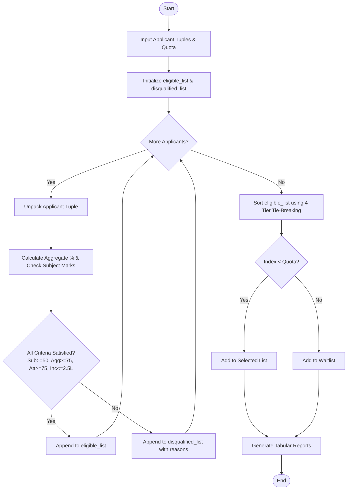

# Case Study 01: University Scholarship Allocation System

## 1. Problem Statement
Write a Python program to check scholarship applications. The program checks marks, attendance, and family income, then ranks the students who are eligible. This problem is meant to practise conditions, loops, lists, and tuples.

---

## 2. Objectives
- Check the marks, attendance, income, and age of each applicant.
- Practise conditions, loops, lists, tuples, and tuple unpacking.
- Sort the eligible students using a few simple tie-breaking rules.
- Put students into selected, waiting, or rejected lists.

---

## 3. Assumptions
1. Each applicant is represented as a structured tuple:
   `(student_id, name, [marks_sub1, marks_sub2, ...], attendance_pct, family_income, age)`
2. Passing standard per subject is an absolute minimum of 50 marks out of 100.
3. Academic excellence requires an overall aggregate percentage of $\ge 75.0\%$.
4. Disciplinary compliance requires a minimum attendance of $\ge 75.0\%$.
5. Financial need ceiling requires an annual family income of $\le \text{INR } 2,50,000$.
6. Quota for awarded scholarships is predefined (e.g., $K = 3$).
7. Tie-breaking rules are applied in descending priority:
   - Primary: Higher Aggregate Percentage
   - Secondary: Higher Attendance Percentage
   - Tertiary: Lower Family Income
   - Quaternary: Younger Age (Date of birth preference)

---

## 4. Algorithm
```
Step 1: Start.
Step 2: Initialize empty lists: eligible_list, disqualified_list, selected_list, and waitlisted_list.
Step 3: Define total_quota and input list of applicant tuples.
Step 4: For each applicant in applicants:
          Unpack (student_id, name, marks, attendance, income, age).
          Initialize marks_sum = 0, all_subjects_passed = True, reasons = [].
          For each mark in marks:
              marks_sum = marks_sum + mark
              If mark < 50:
                  all_subjects_passed = False
          Compute aggregate_pct = marks_sum / length(marks).
          If not all_subjects_passed: Append "Failed subject-wise minimum" to reasons.
          If aggregate_pct < 75.0: Append "Aggregate marks below 75%" to reasons.
          If attendance < 75.0: Append "Attendance below 75%" to reasons.
          If income > 250000: Append "Income exceeds ceiling" to reasons.
          If length(reasons) == 0:
              Append tuple (student_id, name, aggregate_pct, attendance, income, age) to eligible_list.
          Else:
              Append tuple with reasons to disqualified_list.
Step 5: Sort eligible_list using Bubble Sort:
          For i from 0 to len(eligible_list) - 1:
              For j from 0 to len(eligible_list) - i - 2:
                  Compare cand1 and cand2 using tie-breaking hierarchy:
                  If agg1 < agg2 -> Swap.
                  Else if agg1 == agg2 and att1 < att2 -> Swap.
                  Else if agg1 == agg2 and att1 == att2 and inc1 > inc2 -> Swap.
                  Else if agg1 == agg2 and att1 == att2 and inc1 == inc2 and age1 > age2 -> Swap.
Step 6: Allocate candidates based on total_quota:
          For idx from 0 to len(eligible_list) - 1:
              Prepend rank (idx + 1) to tuple.
              If idx < total_quota: Append to selected_list.
              Else: Append to waitlisted_list.
Step 7: Format and display tabular reports for Selected, Waitlisted, and Disqualified cohorts.
Step 8: Stop.
```

---

## 5. Flowchart

### Mermaid Representation


### Text / ASCII Flowchart
```
  +-------------------------------------------------------+
  |                        START                          |
  +-------------------------------------------------------+
                             |
                             v
  +-------------------------------------------------------+
  | Load Applicants: (id, name, marks, att, inc, age)     |
  +-------------------------------------------------------+
                             |
                             v
  +-------------------------------------------------------+
  | FOR each applicant: Check Criteria                   |
  | - Each Subject >= 50?                                |
  | - Aggregate >= 75%?                                  |
  | - Attendance >= 75%?                                 |
  | - Income <= 250,000 INR?                             |
  +-------------------------------------------------------+
              /                               \
       (All Passed)                      (Any Failed)
            /                                   \
           v                                     v
  [Add to Eligible List]               [Add to Disqualified]
           \                                     /
            \                                   /
             +---------------+-----------------+
                             |
                             v
  +-------------------------------------------------------+
  | Sort Eligible List using Custom Bubble Sort:          |
  | 1. Agg (Desc) -> 2. Att (Desc) -> 3. Inc (Asc) -> Age |
  +-------------------------------------------------------+
                             |
                             v
  +-------------------------------------------------------+
  | Partition by Quota: Top K -> Selected, Rest -> Waitlist|
  +-------------------------------------------------------+
                             |
                             v
  +-------------------------------------------------------+
  | Print Formatted Audit and Merit Table                 |
  +-------------------------------------------------------+
                             |
                             v
  +-------------------------------------------------------+
  |                         END                           |
  +-------------------------------------------------------+
```

---

## 6. Pseudocode
```
BEGIN UniversityScholarshipAllocation
    INPUT applicants_list, quota
    SET eligible_list = []
    SET disqualified_list = []

    FOR EACH applicant IN applicants_list DO
        UNPACK applicant INTO (sid, sname, marks, att, inc, sage)
        SET total_marks = 0
        SET passed_all = TRUE
        SET count = LENGTH(marks)

        FOR EACH m IN marks DO
            total_marks = total_marks + m
            IF m < 50 THEN
                passed_all = FALSE
            END IF
        END FOR

        SET agg = total_marks / count
        SET reasons = []

        IF passed_all == FALSE THEN
            APPEND "Subject mark < 50" TO reasons
        END IF
        IF agg < 75.0 THEN
            APPEND "Aggregate < 75%" TO reasons
        END IF
        IF att < 75.0 THEN
            APPEND "Attendance < 75%" TO reasons
        END IF
        IF inc > 250000 THEN
            APPEND "Income > 250k" TO reasons
        END IF

        IF LENGTH(reasons) == 0 THEN
            APPEND (sid, sname, agg, att, inc, sage) TO eligible_list
        ELSE
            APPEND (sid, sname, agg, att, inc, sage, reasons) TO disqualified_list
        END IF
    END FOR

    // Bubble Sort with 4-level tie breaking
    SET n = LENGTH(eligible_list)
    FOR i FROM 0 TO n - 1 DO
        FOR j FROM 0 TO n - i - 2 DO
            UNPACK eligible_list[j] INTO (id1, n1, a1, att1, inc1, ag1)
            UNPACK eligible_list[j+1] INTO (id2, n2, a2, att2, inc2, ag2)
            SET need_swap = FALSE

            IF a1 < a2 THEN
                need_swap = TRUE
            ELSE IF a1 == a2 THEN
                IF att1 < att2 THEN
                    need_swap = TRUE
                ELSE IF att1 == att2 THEN
                    IF inc1 > inc2 THEN
                        need_swap = TRUE
                    ELSE IF inc1 == inc2 THEN
                        IF ag1 > ag2 THEN
                            need_swap = TRUE
                        END IF
                    END IF
                END IF
            END IF

            IF need_swap == TRUE THEN
                SWAP eligible_list[j] AND eligible_list[j+1]
            END IF
        END FOR
    END FOR

    SET selected = []
    SET waitlist = []
    FOR k FROM 0 TO n - 1 DO
        SET record = (k + 1) + eligible_list[k]
        IF k < quota THEN
            APPEND record TO selected
        ELSE
            APPEND record TO waitlist
        END IF
    END FOR

    DISPLAY selected, waitlist, disqualified_list
END
```

---

## 7. Python Source Code
Refer to the complete script in [`problem_01_scholarship_allocation.py`](file:///c:/Users/manikanta/OneDrive/Desktop/python/python%20active%20based/Case_Study_01_University_Scholarship_Allocation/problem_01_scholarship_allocation.py).

---

## 8. Test Cases

| Test Case ID | Scenario / Input Description | Expected Outcome | Actual Result | Status |
| :--- | :--- | :--- | :--- | :--- |
| **TC-01-01** | Identical Aggregate (88.75), Attendance (91.0%), and Income (180,000) between Divya (18 yrs) and Aarav (19 yrs) | Divya ranked ahead of Aarav (Age tie-breaker) | Divya = Rank 3, Aarav = Rank 4 | **PASSED** |
| **TC-01-02** | Exact Boundary condition: 75% agg, 75% att, 250,000 income, each subject 75 | Candidate qualified as eligible | Candidate marked eligible without errors | **PASSED** |
| **TC-01-03** | Multiple simultaneous disqualifications: mark < 50, agg < 75%, income > 250k | Disqualified with all 4 audit reasons logged | Disqualified with 4 reasons logged | **PASSED** |
| **TC-01-04** | Quota restriction test: 3 eligible candidates with Quota = 1 | 1 candidate selected, 2 candidates placed on waitlist | 1 Selected, 2 Waitlisted | **PASSED** |

---

## 9. Output Execution Log
```
======================================================================================
               DR. RVR NRI INSTITUTE OF TECHNOLOGY
       UNIVERSITY SCHOLARSHIP ALLOCATION & MERIT RANKING REPORT
======================================================================================
Total Available Scholarships (Quota): 3
Total Qualified Candidates: 6
Total Disqualified Applicants: 4
--------------------------------------------------------------------------------------

[SECTION 1: SELECTED SCHOLARSHIP RECIPIENTS]
Rank ID          Name              Aggregate %   Att %     Income (INR)  Age  
--------------------------------------------------------------------------------------
1    26B91A0503  Chaitanya V.      93.00         94.0      150,000       19   
2    26B91A0510  Janani Iyer       88.75         93.0      190,000       19   
3    26B91A0504  Divya Sri         88.75         91.0      180,000       18   

[SECTION 2: WAITLISTED CANDIDATES (BEYOND QUOTA)]
Rank ID          Name              Aggregate %   Att %     Income (INR)  Age  
--------------------------------------------------------------------------------------
4    26B91A0501  Aarav Sharma      88.75         91.0      180,000       19   
5    26B91A0502  Bhavya Reddy      81.25         88.5      210,000       18   
6    26B91A0509  Ishaan Verma      81.00         86.0      220,000       19   

[SECTION 3: DISQUALIFIED APPLICANTS & AUDIT TRAIL]
ID          Name              Agg %     Att %   Income      Primary Disqualification Reason
--------------------------------------------------------------------------------------
26B91A0505  Eshwar Rao        77.00     82.0    140,000     Failed subject-wise minimum criterion (< 50 marks)
26B91A0506  Fatima Zahra      71.75     79.0    190,000     Aggregate marks below 75.0% threshold
26B91A0507  Ganesh Kumar      87.00     72.0    160,000     Attendance below 75.0% threshold
26B91A0508  Harini Murthy     91.00     89.0    320,000     Annual family income exceeds INR 2,50,000 ceiling
======================================================================================
```

---

## 10. Conclusion
Case Study 01 demonstrates the power of computational thinking through modular data structures (tuples, nested lists) and custom sorting algorithms without built-in advanced library functions. The deterministic 4-stage tie-breaking hierarchy ensures absolute transparency and fairness in institutional scholarship disbursement.
