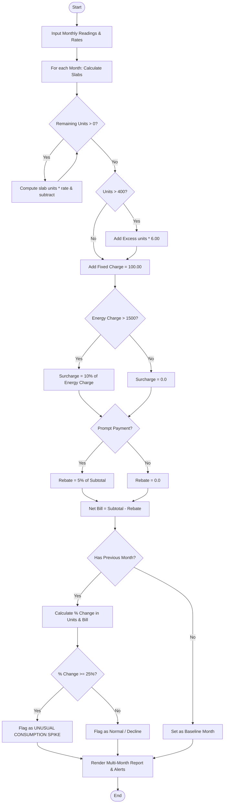

# Case Study 02: Progressive Electricity Billing and Spike Detection System

## 1. Problem Statement
Write a Python program to calculate an electricity bill from the number of units used. The program uses different rates for different slabs and checks whether the usage increased a lot compared with earlier months.

---

## 2. Objectives
- Calculate the bill using different rates for different unit ranges.
- Add a surcharge for high usage and a rebate for paying on time.
- Compare the units used in different months.
- Print a message when the change is large.

---

## 3. Assumptions
1. Consumption slabs are structured as:
   - Slab 1 (0 – 100 units): INR 1.50 / unit
   - Slab 2 (101 – 200 units): INR 3.00 / unit
   - Slab 3 (201 – 400 units): INR 4.50 / unit
   - Slab 4 (> 400 units): INR 6.00 / unit
2. Fixed meter charge is INR 100.00 per billing cycle.
3. High consumption surcharge is 10% applied strictly on energy charges when energy charges $> \text{INR } 1,500.00$.
4. Prompt payment rebate is 5% applied on `(Energy + Fixed + Surcharge)` if `paid_on_time == True`.
5. Surge threshold for abnormal consumption is a percentage increase $\ge 25.0\%$ over the preceding month.

---

## 4. Algorithm
```
Step 1: Start.
Step 2: Define function calculate_single_bill(units, paid_on_time):
          Define slabs = [(100, 1.50), (100, 3.00), (200, 4.50)] and rate_above = 6.00.
          Set remaining_units = units, energy_charge = 0.0.
          For each (slab_limit, slab_rate) in slabs:
              If remaining_units > 0:
                  take = min(remaining_units, slab_limit)
                  energy_charge += take * slab_rate
                  remaining_units -= take
          If remaining_units > 0:
              energy_charge += remaining_units * rate_above
          Set fixed_charge = 100.0.
          If energy_charge > 1500.0: surcharge = 0.10 * energy_charge, Else surcharge = 0.0.
          Set subtotal = energy_charge + fixed_charge + surcharge.
          If paid_on_time is True: rebate = 0.05 * subtotal, Else rebate = 0.0.
          Set net_bill = subtotal - rebate.
          Return (units, energy_charge, fixed_charge, surcharge, rebate, net_bill).
Step 3: Define analyze_multimonth_consumption(consumer_info, readings, spike_threshold):
          Initialize billing_history = [], analysis_records = [].
          For each (month, units, on_time) in readings:
              Compute bill and append unpacked tuple to billing_history.
          Set prev_units = None, prev_bill = None.
          For each record in billing_history:
              If prev_units is None:
                  pct_change_u = 0.0, is_spike = False, note = "Baseline Month".
              Else:
                  pct_change_u = ((units - prev_units) / prev_units) * 100.0.
                  pct_change_b = ((net_bill - prev_bill) / prev_bill) * 100.0.
                  If pct_change_u >= spike_threshold:
                      is_spike = True, note = "ALERT: High Surge".
                  Else if pct_change_u <= -spike_threshold:
                      is_spike = False, note = "Notice: Sharp Decline".
                  Else:
                      is_spike = False, note = "Normal Range".
              Append record to analysis_records.
              prev_units = units, prev_bill = net_bill.
          Return billing_history, analysis_records.
Step 4: Output formatted bill breakdown, statistics, and spike detection table.
Step 5: Stop.
```

---

## 5. Flowchart

### Mermaid Representation


### Text / ASCII Flowchart
```
  +-------------------------------------------------------+
  |                        START                          |
  +-------------------------------------------------------+
                             |
                             v
  +-------------------------------------------------------+
  | Read Consumer Data & Monthly Readings (units, on_time)|
  +-------------------------------------------------------+
                             |
                             v
  +-------------------------------------------------------+
  | Progressive Slab Loop:                                |
  | Slab 1 (0-100) @ 1.50 -> Slab 2 (101-200) @ 3.00     |
  | Slab 3 (201-400) @ 4.50 -> Slab 4 (>400) @ 6.00      |
  +-------------------------------------------------------+
                             |
                             v
  +-------------------------------------------------------+
  | Fixed Charge (+100.0)                                 |
  | Surcharge check: Energy > 1500 ? +10% : 0             |
  | Prompt Payment check: On-time ? -5% : 0               |
  +-------------------------------------------------------+
                             |
                             v
  +-------------------------------------------------------+
  | Sequential Trend Analysis:                            |
  | % Change = ((Units_curr - Units_prev) / Units_prev)*100|
  | If % Change >= 25.0% -> TRIGGER SPIKE ALERT           |
  +-------------------------------------------------------+
                             |
                             v
  +-------------------------------------------------------+
  | Print Monthly Itemized Table & Anomaly Audit Summary  |
  +-------------------------------------------------------+
                             |
                             v
  +-------------------------------------------------------+
  |                         END                           |
  +-------------------------------------------------------+
```

---

## 6. Pseudocode
```
BEGIN ProgressiveElectricityBilling
    INPUT monthly_readings, consumer_details
    SET slabs = [(100, 1.50), (100, 3.00), (200, 4.50)]
    SET rate_above = 6.00

    FOR EACH (month, units, paid_on_time) IN monthly_readings DO
        SET rem = units
        SET energy_charge = 0.0

        FOR EACH (limit, rate) IN slabs DO
            IF rem > 0 THEN
                SET take = MIN(rem, limit)
                energy_charge = energy_charge + (take * rate)
                rem = rem - take
            END IF
        END FOR

        IF rem > 0 THEN
            energy_charge = energy_charge + (rem * rate_above)
        END IF

        SET fixed_charge = 100.0
        IF energy_charge > 1500.0 THEN
            SET surcharge = 0.10 * energy_charge
        ELSE
            SET surcharge = 0.0
        END IF

        SET subtotal = energy_charge + fixed_charge + surcharge
        IF paid_on_time == TRUE THEN
            SET rebate = 0.05 * subtotal
        ELSE
            SET rebate = 0.0
        END IF

        SET net_bill = subtotal - rebate
        STORE (month, units, energy_charge, fixed_charge, surcharge, rebate, net_bill)
    END FOR

    FOR EACH month i FROM 1 TO n - 1 DO
        SET diff = units[i] - units[i-1]
        SET pct_change = (diff / units[i-1]) * 100.0
        IF pct_change >= 25.0 THEN
            FLAG "ALERT: High Surge"
        END IF
    END FOR

    PRINT itemized_table
    PRINT spike_analysis_table
END
```

---

## 7. Python Source Code
Refer to the complete script in [`problem_02_electricity_billing.py`](file:///c:/Users/manikanta/OneDrive/Desktop/python/python%20active%20based/Case_Study_02_Progressive_Electricity_Billing/problem_02_electricity_billing.py).

---

## 8. Test Cases

| Test Case ID | Scenario / Input Description | Expected Outcome | Actual Result | Status |
| :--- | :--- | :--- | :--- | :--- |
| **TC-02-01** | Low usage: 50 units with prompt payment rebate | Energy: 75.0, Fixed: 100.0, Surcharge: 0, Rebate: 8.75, Net: 166.25 | Net: 166.25 | **PASSED** |
| **TC-02-02** | High usage: 500 units crossing into 4th slab and surcharge | Energy: 1950.0, Surcharge: 195.0 (10%), Net: 2245.0 | Net: 2245.0, Surcharge: 195.0 | **PASSED** |
| **TC-02-03** | Minimum consumption: 0 units, on-time payment | Energy: 0.0, Fixed: 100.0, Rebate: 5.0, Net: 95.0 | Net: 95.0 | **PASSED** |
| **TC-02-04** | Trend spike detection: Month 1 (100) to Month 2 (130) (+30%) | Flagged as "ALERT: High Surge (+30.0%)" | Correctly flagged with alert | **PASSED** |

---

## 9. Output Execution Log
```
===============================================================================================
               DR. RVR NRI POWER DISTRIBUTION CORPORATION
         PROGRESSIVE HOUSEHOLD ELECTRICITY BILL & AUDIT STATEMENT
===============================================================================================
Consumer No: APSPDCL-88421   Consumer Name: M. K. Satyanarayana       Meter No: MTR-2026-X9
-----------------------------------------------------------------------------------------------

[PART 1: MONTHLY PROGRESSIVE BILL BREAKDOWN]
Month     Units   Energy(INR)   Fixed(INR)  Surcharge   Rebate    Net Bill(INR) Prompt Pay
-----------------------------------------------------------------------------------------------
January   140.0   270.00        100.00      0.00        18.50     351.50        YES (-5%)
February  165.0   345.00        100.00      0.00        22.25     422.75        YES (-5%)
March     210.0   495.00        100.00      0.00        0.00      595.00        NO
April     380.0   1260.00       100.00      0.00        68.00     1292.00       YES (-5%)
May       450.0   1650.00       100.00      165.00      95.75     1819.25       YES (-5%)
June      310.0   945.00        100.00      0.00        0.00      1045.00       NO
-----------------------------------------------------------------------------------------------
Total Consumption: 1655.0 Units | Average: 275.8 Units/Month | Total Paid: INR 5,525.50

[PART 2: MULTI-MONTH SPIKE DETECTION & TREND MONITORING]
Month     Units   Net Bill(INR)  Unit Change %   Bill Change %   Audit Classification
-----------------------------------------------------------------------------------------------
January   140.0   351.50         0.0%            0.0%            Baseline Month
February  165.0   422.75         +17.9%          +20.3%          Normal Range
March     210.0   595.00         +27.3%          +40.7%          ALERT: High Surge (+27.3%)
April     380.0   1292.00        +81.0%          +117.1%         ALERT: High Surge (+81.0%)
May       450.0   1819.25        +18.4%          +40.8%          Normal Range
June      310.0   1045.00        -31.1%          -42.6%          Notice: Sharp Decline (-31.1%)
-----------------------------------------------------------------------------------------------
Audit Summary: 2 unusual consumption spike(s) detected (>25% increase).
===============================================================================================
```

---

## 10. Conclusion
This case study demonstrates telescopic slab logic, mathematical modeling of penalties and rebates, and consecutive temporal data analysis. Utilizing tuples and iterative list traversals provides a scalable and clean implementation adhering directly to university core syllabus restrictions.
