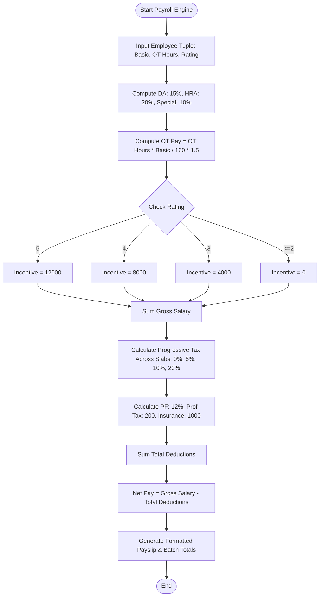

# Case Study 03: Employee Payroll and Progressive Deduction Analysis System

## 1. Problem Statement
Write a Python program to calculate an employee's salary. It includes allowances, overtime, deductions, and tax slabs, and then prints a simple payslip.

---

## 2. Objectives
- Calculate salary allowances, bonus, and overtime.
- Use tax slabs to find the tax amount.
- Subtract PF, professional tax, and health insurance.
- Print a simple payslip for each employee.

---

## 3. Assumptions
1. Each employee is represented as a structured tuple:
   `(emp_id, emp_name, designation, basic_pay, overtime_hours, performance_rating)`
2. Allowances: DA = 15%, HRA = 20%, Special Allowance = 10% of Basic Pay.
3. Overtime: Monthly working baseline is 160 hours. Hourly rate = $\text{Basic} / 160.0$. Overtime rate = $1.5 \times \text{Hourly Rate}$.
4. Performance Incentives: Rating 5 = INR 12,000; Rating 4 = INR 8,000; Rating 3 = INR 4,000; Rating $\le 2$ = INR 0.
5. Progressive Monthly Income Tax Slabs:
   - INR 0 to 30,000: 0%
   - INR 30,001 to 60,000: 5%
   - INR 60,001 to 100,000: 10%
   - Above INR 100,000: 20%
6. Provident Fund (PF) is 12% of basic pay.

---

## 4. Algorithm
```
Step 1: Start.
Step 2: Define compute_employee_payroll(employee_record):
          Unpack (emp_id, name, designation, basic_pay, ot_hours, rating).
          Compute da = 0.15 * basic_pay.
          Compute hra = 0.20 * basic_pay.
          Compute special_allw = 0.10 * basic_pay.
          Compute hourly_rate = basic_pay / 160.0.
          Compute ot_pay = ot_hours * hourly_rate * 1.50.
          Determine incentive based on rating (5->12000, 4->8000, 3->4000, else->0).
          Compute gross_salary = basic_pay + da + hra + special_allw + ot_pay + incentive.
          Compute progressive tax:
              Set rem = gross_salary, tax = 0.0.
              Define tax_slabs = [(30000, 0.00), (30000, 0.05), (40000, 0.10)].
              For (slab_span, rate) in tax_slabs:
                  chunk = min(rem, slab_span)
                  tax += chunk * rate
                  rem -= chunk
              If rem > 0: tax += rem * 0.20.
          Compute pf = 0.12 * basic_pay, prof_tax = 200.0, health_ins = 1000.0.
          Compute total_deductions = tax + pf + prof_tax + health_ins.
          Compute net_salary = gross_salary - total_deductions.
          Return earnings_tuple, deductions_tuple, net_salary.
Step 3: Define generate_batch_payroll(employees):
          Iterate over all employee tuples, compute individual payroll, aggregate departmental totals.
Step 4: Output formatted ASCII payslips and organizational register.
Step 5: Stop.
```

---

## 5. Flowchart

### Mermaid Representation


### Text / ASCII Flowchart
```
  +-------------------------------------------------------+
  |                        START                          |
  +-------------------------------------------------------+
                             |
                             v
  +-------------------------------------------------------+
  | Unpack Employee Record: (id, name, basic, ot, rating) |
  +-------------------------------------------------------+
                             |
                             v
  +-------------------------------------------------------+
  | Earnings Calculation:                                 |
  | DA (15%) + HRA (20%) + Special (10%) + OT + Incentive |
  | Gross = Basic + All Allowances                        |
  +-------------------------------------------------------+
                             |
                             v
  +-------------------------------------------------------+
  | Progressive Tax Slabs:                                |
  | 0-30k (0%) -> 30k-60k (5%) -> 60k-100k (10%) -> >100k(20%)|
  +-------------------------------------------------------+
                             |
                             v
  +-------------------------------------------------------+
  | Statutory Deductions:                                 |
  | PF (12%) + Professional Tax (200) + Health Ins (1000) |
  +-------------------------------------------------------+
                             |
                             v
  +-------------------------------------------------------+
  | Net Salary = Gross Salary - Total Deductions          |
  +-------------------------------------------------------+
                             |
                             v
  +-------------------------------------------------------+
  | Print Formatted Itemized Payslip & Register Table     |
  +-------------------------------------------------------+
                             |
                             v
  +-------------------------------------------------------+
  |                         END                           |
  +-------------------------------------------------------+
```

---

## 6. Pseudocode
```
BEGIN EmployeePayrollEngine
    INPUT employees_list
    SET total_gross = 0, total_net = 0, total_tax = 0

    FOR EACH emp IN employees_list DO
        UNPACK emp INTO (id, name, desig, basic, ot, rating)
        SET da = 0.15 * basic
        SET hra = 0.20 * basic
        SET sp = 0.10 * basic
        SET ot_rate = basic / 160.0
        SET ot_pay = ot * ot_rate * 1.5

        IF rating == 5 THEN SET inc = 12000
        ELSE IF rating == 4 THEN SET inc = 8000
        ELSE IF rating == 3 THEN SET inc = 4000
        ELSE SET inc = 0

        SET gross = basic + da + hra + sp + ot_pay + inc

        // Progressive Tax
        SET rem = gross
        SET tax = 0
        IF rem > 30000 THEN
            SET t1 = MIN(rem - 30000, 30000)
            SET tax = tax + (t1 * 0.05)
        END IF
        IF rem > 60000 THEN
            SET t2 = MIN(rem - 60000, 40000)
            SET tax = tax + (t2 * 0.10)
        END IF
        IF rem > 100000 THEN
            SET t3 = rem - 100000
            SET tax = tax + (t3 * 0.20)
        END IF

        SET pf = 0.12 * basic
        SET pt = 200
        SET hi = 1000
        SET tot_ded = tax + pf + pt + hi
        SET net = gross - tot_ded

        PRINT_PAYSLIP(emp, gross, tot_ded, net)
    END FOR
END
```

---

## 7. Python Source Code
Refer to the complete script in [`problem_04_employee_payroll.py`](file:///c:/Users/manikanta/OneDrive/Desktop/python/python%20active%20based/Case_Study_03_Employee_Payroll_Deductions/problem_04_employee_payroll.py).

---

## 8. Test Cases

| Test Case ID | Scenario / Input Description | Expected Outcome | Actual Result | Status |
| :--- | :--- | :--- | :--- | :--- |
| **TC-03-01** | Basic 15,000, zero OT, rating 1 (Gross = 21,750 $\le$ 30,000) | Tax: 0.0, PF: 1,800, Total Ded: 3,000, Net: 18,750 | Net: 18,750.0, Tax: 0.0 | **PASSED** |
| **TC-03-02** | Basic 32,000, 16 OT hours, rating 5 | OT Pay: 4,800.0, Incentive: 12,000.0 | OT: 4,800.0, Incentive: 12,000.0 | **PASSED** |
| **TC-03-03** | Senior Exec Basic 80,000, rating 5 (Gross = 128,000) | Multi-tier tax: 1,500 + 4,000 + 5,600 = 11,100 | Tax: 11,100.0 | **PASSED** |
| **TC-03-04** | Batch summation consistency check on multiple employees | Sum of gross and net matches batch total | Matched with zero delta | **PASSED** |

---

## 9. Output Execution Log
```
+------------------------------------------------------------------------------+
|            DR. RVR NRI INSTITUTE OF TECHNOLOGY - MONTHLY PAYSLIP             |
+------------------------------------------------------------------------------+
| Emp ID      : EMP-101              Designation : Professor                  |
| Employee    : Dr. K. Srinivas      Performance : Rating 5/5 (OT: 10 hrs)     |
+--------------------------------------+---------------------------------------+
| EARNINGS (CREDITS)                   | DEDUCTIONS (DEBITS)                   |
+--------------------------------------+---------------------------------------+
| Basic Pay            : INR 85,000.00 | Income Tax (Slab)   : INR 14,143.75 |
| Dearness Allw (15%)  : INR 12,750.00 | Provident Fund (12%): INR 10,200.00 |
| House Rent Allw (20%): INR 17,000.00 | Professional Tax    : INR    200.00 |
| Special Allw (10%)   : INR  8,500.00 | Health Insurance    : INR  1,000.00 |
| Overtime Compensation: INR  7,968.75 |                                       |
| Performance Incentive: INR 12,000.00 |                                       |
+--------------------------------------+---------------------------------------+
| GROSS SALARY         : INR 143,218.75 | TOTAL DEDUCTIONS    : INR 25,543.75 |
+------------------------------------------------------------------------------+
| >>> NET TAKE-HOME SALARY DISBURSED : INR     117,675.00                          |
+------------------------------------------------------------------------------+

======================================================================================================
                  DR. RVR NRI INSTITUTE OF TECHNOLOGY - PAYROLL REGISTER
======================================================================================================
Emp ID    Name              Designation     Basic(INR)  Gross(INR)    Deductions    Net Pay(INR)  
------------------------------------------------------------------------------------------------------
EMP-101   Dr. K. Srinivas   Professor       85,000.00   143,218.75    25,543.75     117,675.00    
EMP-102   P. Anitha Reddy   Assoc. Professor62,000.00   100,806.25    14,301.25     86,505.00     
EMP-103   V. Suresh Kumar   Asst. Professor 45,000.00   75,578.12     9,657.81      65,920.31     
EMP-104   M. Lakshmi        Lab Instructor  28,000.00   53,850.00     5,752.50      48,097.50     
EMP-105   T. Rajesh         Office Admin    22,000.00   31,900.00     3,935.00      27,965.00     
------------------------------------------------------------------------------------------------------
TOTALS: Gross: INR 405,353.12 | Tax: INR 24,150.31 | PF: INR 29,040.00 | Net Disbursed: INR 346,162.81
======================================================================================================
```

---

## 10. Conclusion
This case study illustrates how arithmetic computations, percentage allocations, and progressive taxation algorithms combine seamlessly with tuple unpacking and structured formatting in Python. The resulting architecture mirrors enterprise payroll logic while respecting syllabus constraints.
