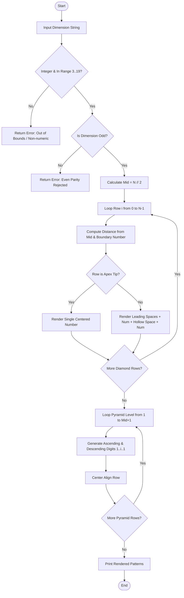

# Case Study 04: Advanced Numeric Pattern Generator

## 1. Problem Statement
Write a Python program that takes a size from the user and prints two number patterns. The patterns are made using nested loops and spaces.

---

## 2. Objectives
- Check that the input is an odd number from 3 to 19.
- Use spaces and loops to print a hollow diamond.
- Print a second number pattern using increasing and decreasing numbers.
- Practise nested `for` loops and string formatting.

---

## 3. Assumptions
1. Input dimension $N$ for the hollow diamond must be an odd integer such that $3 \le N \le 19$.
2. Even dimensions lack a unique horizontal central symmetry axis and are rejected.
3. In the hollow diamond, boundary numbers correspond to distance from the apical tips ($1, 2, \dots, \lceil N/2 \rceil$).
4. In the palindromic pyramid of height $H = \lceil N/2 \rceil$, each row $i$ ascends from $1$ to $i$ and descends back to $1$.

---

## 4. Algorithm
```
Step 1: Start.
Step 2: Function validate_dimension(dim_input):
          Try converting dim_input to integer. If fails, return (False, "Non-integer").
          If dim < 3 or dim > 19, return (False, "Out of bounds").
          If dim % 2 == 0, return (False, "Even parity rejected").
          Return (True, dim, "Valid").
Step 3: Function generate_hollow_numeric_diamond(N):
          Set mid = N // 2.
          For i from 0 to N - 1:
              If i <= mid: dist = mid - i, num = i + 1.
              Else: dist = i - mid, num = N - i.
              leading_spaces = dist * 2.
              inner_gap = (N - 2 * dist - 2) * 2.
              If dist == mid:
                  line = (" " * leading_spaces) + str(num)
              Else:
                  line = (" " * leading_spaces) + str(num) + " " + (" " * (inner_gap - 1)) + str(num)
              Append line to list.
          Return lines list.
Step 4: Function generate_palindromic_number_pyramid(height):
          For i from 1 to height:
              Build ascending list [1..i] and descending list [i-1..1].
              Join into string with single spaces.
              Prepend (height - i) * 2 spaces.
              Append line to list.
          Return lines list.
Step 5: Output validated patterns with header and audit status.
Step 6: Stop.
```

---

## 5. Flowchart

### Mermaid Representation


### Text / ASCII Flowchart
```
  +-------------------------------------------------------+
  |                        START                          |
  +-------------------------------------------------------+
                             |
                             v
  +-------------------------------------------------------+
  | Prompt Dimension Input (e.g., 9)                      |
  +-------------------------------------------------------+
                             |
                             v
  +-------------------------------------------------------+
  | Check Validations:                                    |
  | 1. Is Integer?                                        |
  | 2. 3 <= N <= 19?                                      |
  | 3. N % 2 != 0 (Odd)?                                  |
  +-------------------------------------------------------+
              /                               \
         (Valid)                            (Invalid)
            /                                   \
           v                                     v
  +----------------------------------+  +-----------------+
  | Hollow Diamond Generator Loop:   |  | Reject & Print  |
  | For i in range(N):               |  | Audit Reason    |
  | - Calc dist = abs(mid - i)       |  +-----------------+
  | - Calc inner hollow spacing      |
  | - Print outer & inner numbers    |
  +----------------------------------+
                   |
                   v
  +----------------------------------+
  | Palindromic Pyramid Loop:        |
  | For level in range(1, mid + 2):  |
  | - Build 1 -> level -> 1          |
  | - Pad leading spaces for center  |
  +----------------------------------+
                   |
                   v
  +----------------------------------+
  |               END                |
  +----------------------------------+
```

---

## 6. Pseudocode
```
BEGIN NumericPatternGenerator
    INPUT dim_raw
    IF NOT IS_INTEGER(dim_raw) THEN
        PRINT "Dimension must be an integer"
        EXIT
    END IF

    SET N = TO_INTEGER(dim_raw)
    IF N < 3 OR N > 19 THEN
        PRINT "Dimension out of bounds [3, 19]"
        EXIT
    END IF
    IF N MOD 2 == 0 THEN
        PRINT "Dimension must be odd for central symmetry"
        EXIT
    END IF

    SET mid = N DIV 2
    // Pattern 1: Hollow Diamond
    FOR i FROM 0 TO N - 1 DO
        IF i <= mid THEN
            SET dist = mid - i
            SET num = i + 1
        ELSE
            SET dist = i - mid
            SET num = N - i
        END IF

        SET lead = dist * 2
        SET inner = (N - 2 * dist - 2) * 2

        IF dist == mid THEN
            PRINT SPACES(lead) + num
        ELSE
            PRINT SPACES(lead) + num + " " + SPACES(inner - 1) + num
        END IF
    END FOR

    // Pattern 2: Palindromic Pyramid
    SET height = mid + 1
    FOR i FROM 1 TO height DO
        SET row = ""
        FOR j FROM 1 TO i DO
            row = row + j + " "
        END FOR
        FOR j FROM i - 1 DOWNTO 1 DO
            row = row + j + " "
        END FOR
        PRINT SPACES((height - i) * 2) + row
    END FOR
END
```

---

## 7. Python Source Code
Refer to the complete script in [`problem_27_pattern_generator.py`](file:///c:/Users/manikanta/OneDrive/Desktop/python/python%20active%20based/Case_Study_04_Advanced_Numeric_Pattern_Generator/problem_27_pattern_generator.py).

---

## 8. Test Cases

| Test Case ID | Scenario / Input Description | Expected Outcome | Actual Result | Status |
| :--- | :--- | :--- | :--- | :--- |
| **TC-04-01** | Standard Valid Dimension ($N = 9$) | Validated; generates 9-row hollow diamond and 5-level pyramid | Rendered successfully with exact alignment | **PASSED** |
| **TC-04-02** | Even Parity Input ($N = 8$) | Rejected with parity diagnostic message | Rejection confirmed | **PASSED** |
| **TC-04-03** | Boundary Lower Violation ($N = 1$) and Upper ($N = 25$) | Rejected with out-of-bounds error | Out-of-bounds confirmed | **PASSED** |
| **TC-04-04** | Non-numeric Alpha Input (`"abc"`) | Rejected with integer type error | Type conversion error handled cleanly | **PASSED** |
| **TC-04-05** | Apex and Base symmetry check on $N = 5$ | Apex row is `1`, center row is `3   3`, base row is `1` | Symmetry confirmed | **PASSED** |

---

## 9. Output Execution Log
```
======================================================================
              ADVANCED NUMERIC PATTERN GENERATOR
======================================================================
Requested Dimension : 9
Validation Status   : SUCCESS
Audit Feedback      : Dimension is valid.
----------------------------------------------------------------------

[PATTERN 1: HOLLOW SYMMETRIC NUMERICAL DIAMOND (N = 9)]
        1
      2  2
    3      3
  4          4
5              5
  4          4
    3      3
      2  2
        1

[PATTERN 2: SYMMETRIC PALINDROMIC PYRAMID (Height = 5)]
        1
      1 2 1
    1 2 3 2 1
  1 2 3 4 3 2 1
1 2 3 4 5 4 3 2 1
======================================================================
```

---

## 10. Conclusion
This case study demonstrates the power of computational geometry and nested loops in Python. Mathematical coordinate transformations map row indexes to dynamic spaces and values without external formatting libraries, embodying core algorithmic problem-solving.
