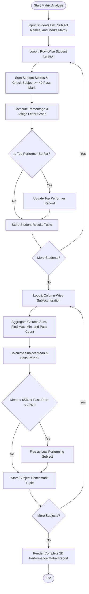

# Case Study 06: Student Marks Matrix Analysis System

## 1. Problem Statement
Write a Python program to analyse marks stored in a two-dimensional list. It finds totals, percentages, grades, subject averages, and the students with the highest marks.

---

## 2. Objectives
- Store the marks in a nested list.
- Find each student's total, average, grade, and pass or fail result.
- Find the average and pass percentage for every subject.
- Show subjects that may need more practice.

---

## 3. Assumptions
1. Assessment marks are organized in a 2D matrix (nested list): `marks_matrix[student_index][subject_index]`.
2. Each subject has a maximum achievable score of 100 marks.
3. Minimum passing score in any individual subject is 40 marks.
4. Grading criteria (based on percentage, provided all subjects are passed):
   - $\ge 85\%$: O (Outstanding)
   - $75\% \text{ to } 84.9\%$: A+ (Excellent)
   - $65\% \text{ to } 74.9\%$: A (Very Good)
   - $55\% \text{ to } 64.9\%$: B (Good)
   - $40\% \text{ to } 54.9\%$: C (Pass)
   - $< 40\%$ or any subject failed: F (Fail)
5. A subject is flagged for institutional review if its average score $< 65.0\%$ or pass percentage $< 70.0\%$.

---

## 4. Algorithm
```
Step 1: Start.
Step 2: Function analyze_marks_matrix(students, subjects, marks_matrix):
          Set num_students = len(students), num_subjects = len(subjects).
          Initialize student_results = [], highest_total = -1, top_performer = None.
          // Row-wise traversal
          For i from 0 to num_students - 1:
              Set row_marks = marks_matrix[i], row_total = 0, all_passed = True.
              For each mark m in row_marks:
                  row_total += m
                  If m < 40: all_passed = False
              avg = row_total / num_subjects.
              grade = determine_grade(avg, all_passed).
              status = "PASSED" if all_passed else "FAILED".
              Append (roll, name, row_marks, row_total, avg, grade, status) to student_results.
              If all_passed and row_total > highest_total:
                  highest_total = row_total, top_performer = (roll, name, row_total, avg).
          // Column-wise traversal
          Initialize subject_stats = [], low_performing_subjects = [].
          For j from 0 to num_subjects - 1:
              Set col_sum = 0, col_max = -1, col_min = 1000, pass_count = 0.
              For i from 0 to num_students - 1:
                  score = marks_matrix[i][j]
                  col_sum += score
                  If score > col_max: col_max = score
                  If score < col_min: col_min = score
                  If score >= 40: pass_count += 1
              sub_avg = col_sum / num_students.
              sub_pass_pct = (pass_count / num_students) * 100.0.
              stat_tuple = (subjects[j], sub_avg, col_max, col_min, sub_pass_pct).
              Append stat_tuple to subject_stats.
              If sub_avg < 65.0 or sub_pass_pct < 70.0:
                  Append stat_tuple to low_performing_subjects.
          Return student_results, subject_stats, top_performer, low_performing_subjects.
Step 3: Print formatted 2D assessment grid, subject statistics, and audit conclusions.
Step 4: Stop.
```

---

## 5. Flowchart

### Mermaid Representation


### Text / ASCII Flowchart
```
  +-------------------------------------------------------+
  |                        START                          |
  +-------------------------------------------------------+
                             |
                             v
  +-------------------------------------------------------+
  | Load 2D Marks Matrix: M Students x N Subjects         |
  +-------------------------------------------------------+
                             |
                             v
  +-------------------------------------------------------+
  | ROW-WISE LOOP (For i in 0..M-1):                      |
  | - Accumulate Total = Sum(matrix[i][j])                |
  | - Verify every mark >= 40                             |
  | - Determine Grade & Status (PASSED/FAILED)            |
  | - Track Class Top Performer                           |
  +-------------------------------------------------------+
                             |
                             v
  +-------------------------------------------------------+
  | COLUMN-WISE LOOP (For j in 0..N-1):                   |
  | - Accumulate Col_Sum = Sum(matrix[i][j])              |
  | - Track Max(col) and Min(col)                         |
  | - Calculate Subject Mean & Pass Rate                  |
  | - Flag Low-Performing Subjects (<65% average)         |
  +-------------------------------------------------------+
                             |
                             v
  +-------------------------------------------------------+
  | Print Formatted 2D Matrix Grid & Executive Audit      |
  +-------------------------------------------------------+
                             |
                             v
  +-------------------------------------------------------+
  |                         END                           |
  +-------------------------------------------------------+
```

---

## 6. Pseudocode
```
BEGIN MarksMatrixAnalysis
    INPUT students, subjects, matrix
    SET M = LENGTH(students)
    SET N = LENGTH(subjects)

    // Row-Wise Processing
    FOR i FROM 0 TO M - 1 DO
        SET row_sum = 0
        SET passed = TRUE
        FOR j FROM 0 TO N - 1 DO
            SET score = matrix[i][j]
            row_sum = row_sum + score
            IF score < 40 THEN
                passed = FALSE
            END IF
        END FOR
        SET avg = row_sum / N
        SET grade = GET_GRADE(avg, passed)
        SET status = passed ? "PASSED" : "FAILED"
        STORE (students[i], row_sum, avg, grade, status)
    END FOR

    // Column-Wise Processing
    FOR j FROM 0 TO N - 1 DO
        SET col_sum = 0
        SET mx = -1
        SET mn = 1000
        SET pass_cnt = 0
        FOR i FROM 0 TO M - 1 DO
            SET val = matrix[i][j]
            col_sum = col_sum + val
            IF val > mx THEN mx = val END IF
            IF val < mn THEN mn = val END IF
            IF val >= 40 THEN pass_cnt = pass_cnt + 1 END IF
        END FOR
        SET s_avg = col_sum / M
        SET s_rate = (pass_cnt / M) * 100.0
        STORE (subjects[j], s_avg, mx, mn, s_rate)
        IF s_avg < 65.0 OR s_rate < 70.0 THEN
            FLAG_REMEDIAL(subjects[j])
        END IF
    END FOR

    PRINT_REPORTS()
END
```

---

## 7. Python Source Code
Refer to the complete script in [`problem_42_marks_matrix_analysis.py`](file:///c:/Users/manikanta/OneDrive/Desktop/python/python%20active%20based/Case_Study_06_Student_Marks_Matrix_Analysis/problem_42_marks_matrix_analysis.py).

---

## 8. Test Cases

| Test Case ID | Scenario / Input Description | Expected Outcome | Actual Result | Status |
| :--- | :--- | :--- | :--- | :--- |
| **TC-06-01** | Standard 2x2 grid with known totals: Alice [90, 80], Bob [50, 40] | Alice Total = 170 (85.0%), Bob Total = 90 (45.0%); Math Mean = 70.0 | Matches expected sums and averages | **PASSED** |
| **TC-06-02** | Single subject mark $< 40$ (Fail override) with high aggregate | Marked FAILED with Grade F despite high average | Correctly classified as FAILED | **PASSED** |
| **TC-06-03** | Low performing subject detection ($< 65\%$ mean benchmark) | Physics (mean 60.0%) flagged for remedial attention | Correctly flagged | **PASSED** |
| **TC-06-04** | Subject pass percentage calculation with failing students | Physics pass rate = 50.0% (1 passed out of 2) | Exact 50.0% calculated | **PASSED** |

---

## 9. Output Execution Log
```
==============================================================================================================
                      DR. RVR NRI INSTITUTE OF TECHNOLOGY
                2D MARKS MATRIX ACADEMIC PERFORMANCE AUDIT REPORT
==============================================================================================================
Roll No     Student Name       Python Pro Data Struc Digital Lo Discrete M Eng Physic   Total   Avg %           Grade    Status
--------------------------------------------------------------------------------------------------------------
26B91A0501  Aarav Sharma               88         92         85         90         84     439    87.8 O (Outstanding)    PASSED
26B91A0502  Bhavya Reddy               75         78         68         72         70     363    72.6   A (Very Good)    PASSED
26B91A0503  Chaitanya V.               94         96         91         95         92     468    93.6 O (Outstanding)    PASSED
26B91A0504  Divya Sri                  82         85         80         84         81     412    82.4  A+ (Excellent)    PASSED
26B91A0505  Eshwar Rao                 32         60         55         45         50     242    48.4        F (Fail)    FAILED
26B91A0506  Fatima Zahra               70         72         58         62         65     327    65.4   A (Very Good)    PASSED
--------------------------------------------------------------------------------------------------------------

[PART 2: SUBJECT-WISE COLUMN STATISTICS & CURRICULAR BENCHMARKS]
Subject Name             Subject Mean    Highest Mark    Lowest Mark     Pass Rate %     
--------------------------------------------------------------------------------------------------------------
Python Prog              73.50           94              32              83.3            %
Data Struct              80.50           96              60              100.0           %
Digital Logic            72.83           91              55              100.0           %
Discrete Math            74.67           95              45              100.0           %
Eng Physics              73.67           92              50              100.0           %
--------------------------------------------------------------------------------------------------------------

[PART 3: EXECUTIVE AUDIT FINDINGS]
> Institutional Top Performer : Chaitanya V. (26B91A0503) | Aggregate Score: 468 (93.60%)
> All curricular subjects meet or exceed established institutional performance thresholds.
==============================================================================================================
```

---

## 10. Conclusion
Nested lists provide a natural representation for multidimensional tabular structures. Navigating 2D data via row-major and column-major loops delivers comprehensive academic insights without dependence on external data science packages.
