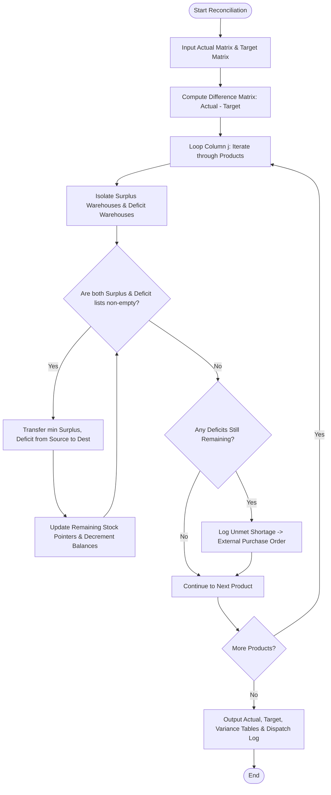

# Case Study 07: Multi-Warehouse Inventory Matrix Reconciliation System

## 1. Problem Statement
Write a Python program to compare the stock available in different warehouses with the required stock. It shows shortages and extra items, and suggests transfers between warehouses using nested lists.

---

## 2. Objectives
- Store the actual and required stock in nested lists.
- Find extra stock and shortage for every warehouse.
- Suggest transfers from a warehouse with extra stock to one with a shortage.
- Show products that still need to be purchased.

---

## 3. Assumptions
1. Facilities and inventory categories are structured as $M \times N$ matrices:
   - $M$ Warehouses: `['WH-1 Central Eluru', 'WH-2 North Vijayawada', 'WH-3 East Guntur', 'WH-4 South Mangalagiri']`.
   - $N$ Products: `['Laptops', 'Servers', 'Routers', 'Projectors', 'Smartboards']`.
2. Actual stock and target stock values are non-negative integers.
3. Intra-network transfers carry zero transfer loss; transferred quantities immediately balance target deficits.
4. If total surplus across all warehouses for a product is less than total deficit, remaining unmet quantities require external replenishment.

---

## 4. Algorithm
```
Step 1: Start.
Step 2: Function reconcile_inventory(warehouses, products, actual, target):
          Set num_wh = len(warehouses), num_prod = len(products).
          Initialize diff_matrix = []
          For i from 0 to num_wh - 1:
              row = []
              For j from 0 to num_prod - 1:
                  row.append(actual[i][j] - target[i][j])
              diff_matrix.append(row)
          Initialize transfer_schedule = [], unmet_deficits = [].
          For j from 0 to num_prod - 1:
              prod_name = products[j]
              surplus_list = [], deficit_list = [].
              For i from 0 to num_wh - 1:
                  d = diff_matrix[i][j]
                  If d > 0: surplus_list.append([i, d])
                  Else if d < 0: deficit_list.append([i, abs(d)])
              s_idx = 0, d_idx = 0
              While s_idx < len(surplus_list) and d_idx < len(deficit_list):
                  src_wh, s_qty = surplus_list[s_idx]
                  dst_wh, d_qty = deficit_list[d_idx]
                  transfer_qty = min(s_qty, d_qty)
                  Append (warehouses[src_wh], warehouses[dst_wh], prod_name, transfer_qty) to transfer_schedule.
                  surplus_list[s_idx][1] -= transfer_qty
                  deficit_list[d_idx][1] -= transfer_qty
                  If surplus_list[s_idx][1] == 0: s_idx += 1
                  If deficit_list[d_idx][1] == 0: d_idx += 1
              While d_idx < len(deficit_list):
                  dst_wh, rem = deficit_list[d_idx]
                  If rem > 0:
                      Append (warehouses[dst_wh], prod_name, rem) to unmet_deficits.
                  d_idx += 1
          Return diff_matrix, transfer_schedule, unmet_deficits.
Step 3: Print formatted actual matrix, target matrix, variance matrix, transfer orders, and procurement alerts.
Step 4: Stop.
```

---

## 5. Flowchart

### Mermaid Representation


### Text / ASCII Flowchart
```
  +-------------------------------------------------------+
  |                        START                          |
  +-------------------------------------------------------+
                             |
                             v
  +-------------------------------------------------------+
  | Load Actual Matrix & Target Matrix (M x N)            |
  +-------------------------------------------------------+
                             |
                             v
  +-------------------------------------------------------+
  | Variance Computation:                                 |
  | diff[i][j] = actual[i][j] - target[i][j]              |
  +-------------------------------------------------------+
                             |
                             v
  +-------------------------------------------------------+
  | FOR EACH product j:                                   |
  | - Filter Surplus nodes (diff > 0)                     |
  | - Filter Deficit nodes (diff < 0)                     |
  | - Greedy Rebalance:                                   |
  |   transfer = min(surplus, deficit)                    |
  |   record (source, destination, product, transfer)     |
  +-------------------------------------------------------+
                             |
                             v
  +-------------------------------------------------------+
  | Unmet Deficit Audit:                                  |
  | If network surplus exhausted but deficit remains,     |
  | flag for external procurement                         |
  +-------------------------------------------------------+
                             |
                             v
  +-------------------------------------------------------+
  | Render Variance Grid & Recommended Transfer Dispatches|
  +-------------------------------------------------------+
                             |
                             v
  +-------------------------------------------------------+
  |                         END                           |
  +-------------------------------------------------------+
```

---

## 6. Pseudocode
```
BEGIN InventoryReconciliation
    INPUT warehouses, products, actual, target
    SET M = LENGTH(warehouses)
    SET N = LENGTH(products)

    // Compute Variance
    FOR i FROM 0 TO M - 1 DO
        FOR j FROM 0 TO N - 1 DO
            SET diff[i][j] = actual[i][j] - target[i][j]
        END FOR
    END FOR

    SET transfers = []
    SET unmet = []

    // Greedy Column-Wise Rebalancing
    FOR j FROM 0 TO N - 1 DO
        SET surpluses = []
        SET deficits = []
        FOR i FROM 0 TO M - 1 DO
            IF diff[i][j] > 0 THEN APPEND [i, diff[i][j]] TO surpluses END IF
            IF diff[i][j] < 0 THEN APPEND [i, -diff[i][j]] TO deficits END IF
        END FOR

        SET s = 0, d = 0
        WHILE s < LENGTH(surpluses) AND d < LENGTH(deficits) DO
            SET transfer_qty = MIN(surpluses[s][1], deficits[d][1])
            APPEND (warehouses[surpluses[s][0]], warehouses[deficits[d][0]], products[j], transfer_qty) TO transfers
            surpluses[s][1] = surpluses[s][1] - transfer_qty
            deficits[d][1] = deficits[d][1] - transfer_qty
            IF surpluses[s][1] == 0 THEN s = s + 1 END IF
            IF deficits[d][1] == 0 THEN d = d + 1 END IF
        END WHILE

        WHILE d < LENGTH(deficits) DO
            IF deficits[d][1] > 0 THEN
                APPEND (warehouses[deficits[d][0]], products[j], deficits[d][1]) TO unmet
            END IF
            d = d + 1
        END WHILE
    END FOR

    PRINT_REPORTS(actual, target, diff, transfers, unmet)
END
```

---

## 7. Python Source Code
Refer to the complete script in [`problem_46_inventory_reconciliation.py`](file:///c:/Users/manikanta/OneDrive/Desktop/python/python%20active%20based/Case_Study_07_Inventory_Matrix_Reconciliation/problem_46_inventory_reconciliation.py).

---

## 8. Test Cases

| Test Case ID | Scenario / Input Description | Expected Outcome | Actual Result | Status |
| :--- | :--- | :--- | :--- | :--- |
| **TC-07-01** | Exact balanced 1-to-1 transfer: WH-A (+20), WH-B (-20) | Transfer 20 units WH-A $\rightarrow$ WH-B; zero unmet deficits | Transferred 20; zero unmet | **PASSED** |
| **TC-07-02** | Partial rebalancing: WH-A (+5 surplus), WH-B (-20 deficit) | Transfer 5 units WH-A $\rightarrow$ WH-B; 15 units flagged unmet | Transferred 5; 15 unmet logged | **PASSED** |
| **TC-07-03** | Perfectly balanced network: actual equals target for all nodes | 0 transfers generated; 0 unmet deficits | 0 transfers; 0 unmet | **PASSED** |
| **TC-07-04** | Multiple sources rebalancing single destination: W1 (+10), W2 (+15), W3 (-25) | 2 sequential transfers dispatched satisfying total 25 deficit | 2 transfers totaling 25 dispatched | **PASSED** |

---

## 9. Output Execution Log
```
=========================================================================================================
                      DR. RVR NRI INSTITUTE OF TECHNOLOGY
          MULTI-WAREHOUSE INVENTORY MATRIX AUDIT & RECONCILIATION REPORT
=========================================================================================================
Warehouse Location               Laptops       Servers       Routers    Projectors   Smartboards
---------------------------------------------------------------------------------------------------------
[SECTION 1: ACTUAL STOCK INVENTORY MATRIX]
WH-1 Central Eluru                    50            12            80            25            15
WH-2 North Vijayawada                 15             4            20            10             5
WH-3 East Guntur                      30            15            60            18            12
WH-4 South Mangalagiri                10             2            15             5             3

[SECTION 2: TARGET THRESHOLD MATRIX]
WH-1 Central Eluru                    30             8            40            15            10
WH-2 North Vijayawada                 25             8            40            15            10
WH-3 East Guntur                      25             8            40            15            10
WH-4 South Mangalagiri                25             8            40            15            10

[SECTION 3: VARIANCE MATRIX (+Surplus / -Shortage)]
WH-1 Central Eluru                   +20            +4           +40           +10            +5
WH-2 North Vijayawada                -10            -4           -20            -5            -5
WH-3 East Guntur                      +5            +7           +20            +3            +2
WH-4 South Mangalagiri               -15            -6           -25           -10            -7
---------------------------------------------------------------------------------------------------------

[SECTION 4: RECOMMENDED INTER-WAREHOUSE STOCK TRANSFERS]
Source Warehouse          Destination Warehouse     Product Name      Transfer Qty
---------------------------------------------------------------------------------------------------------
WH-1 Central Eluru        WH-2 North Vijayawada     Laptops           10          
WH-1 Central Eluru        WH-4 South Mangalagiri    Laptops           10          
WH-3 East Guntur          WH-4 South Mangalagiri    Laptops           5           
WH-1 Central Eluru        WH-2 North Vijayawada     Servers           4           
WH-3 East Guntur          WH-4 South Mangalagiri    Servers           6           
WH-1 Central Eluru        WH-2 North Vijayawada     Routers           20          
WH-1 Central Eluru        WH-4 South Mangalagiri    Routers           20          
WH-3 East Guntur          WH-4 South Mangalagiri    Routers           5           
WH-1 Central Eluru        WH-2 North Vijayawada     Projectors        5           
WH-1 Central Eluru        WH-4 South Mangalagiri    Projectors        5           
WH-3 East Guntur          WH-4 South Mangalagiri    Projectors        3           
WH-1 Central Eluru        WH-2 North Vijayawada     Smartboards       5           
WH-3 East Guntur          WH-4 South Mangalagiri    Smartboards       2           
---------------------------------------------------------------------------------------------------------

[SECTION 5: UNMET NETWORK SHORTAGES (EXTERNAL PROCUREMENT NEEDED)]
> Shortage Alert: WH-4 South Mangalagiri requires 2 units of 'Projectors' [External Purchase Required]
> Shortage Alert: WH-4 South Mangalagiri requires 5 units of 'Smartboards' [External Purchase Required]
=========================================================================================================
```

---

## 10. Conclusion
This case study demonstrates multi-dimensional nested list manipulation applied to real-world supply-chain optimization. Pointer-based greedy inventory transfer logic seamlessly resolves intra-network imbalances while identifying external procurement requirements.
