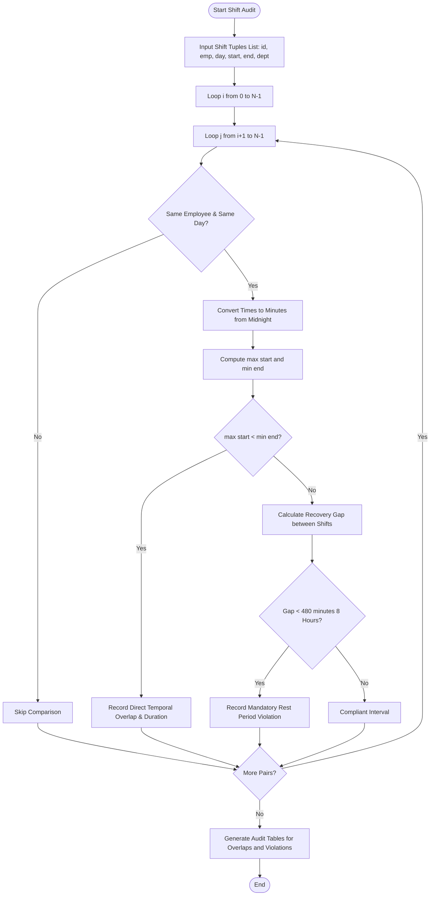

# Case Study 08: Tuple-Based Employee Shift Conflict Detection Engine

## 1. Problem Statement
Write a Python program to store employee shifts as tuples and find overlapping shifts. It also checks whether an employee has enough rest time between two shifts.

---

## 2. Objectives
- Store every shift as a tuple.
- Convert a time such as `08:30` into minutes.
- Compare two shifts for the same employee and day.
- Report overlapping shifts and breaks shorter than eight hours.

---

## 3. Assumptions
1. Shifts are immutable tuples adhering strictly to 24-hour format: `"HH:MM"` (e.g., `"08:00"` to `"16:30"`).
2. Shifts are defined within single calendar days (00:00 to 23:59).
3. A conflict occurs when:
   - Same `emp_id` and same `day_of_week`.
   - Direct overlap: $\max(\text{start}_1, \text{start}_2) < \min(\text{end}_1, \text{end}_2)$.
   - Insufficient recovery: $0 \le (\text{start}_{\text{later}} - \text{end}_{\text{earlier}}) < 480 \text{ minutes}$.
4. Roster processing handles multiple campus departments (Labs, Server Room, Workshops, Library).

---

## 4. Algorithm
```
Step 1: Start.
Step 2: Function parse_time_to_minutes(time_str):
          Split string by ':' into hours and minutes.
          Return hours * 60 + minutes.
Step 3: Function detect_shift_conflicts(shifts, min_rest_hours=8):
          Set min_rest_minutes = min_rest_hours * 60.
          Initialize direct_overlaps = [], rest_violations = [].
          Set n = len(shifts).
          For i from 0 to n - 1:
              For j from i + 1 to n - 1:
                  Unpack shifts[i] into (s1_id, e1_id, name1, day1, st1_str, et1_str, dept1).
                  Unpack shifts[j] into (s2_id, e2_id, name2, day2, st2_str, et2_str, dept2).
                  If e1_id == e2_id and day1.lower() == day2.lower():
                      Convert start and end strings to minutes: st1, et1, st2, et2.
                      Compute overlap_start = max(st1, st2).
                      Compute overlap_end = min(et1, et2).
                      If overlap_start < overlap_end:
                          duration = overlap_end - overlap_start
                          Append collision record to direct_overlaps.
                      Else:
                          If et1 <= st2: gap = st2 - et1, earlier = s1_id, later = s2_id
                          Else: gap = st1 - et2, earlier = s2_id, later = s1_id
                          If 0 <= gap < min_rest_minutes:
                              Append violation record to rest_violations.
          Return direct_overlaps, rest_violations.
Step 4: Output formatted roster overview, direct overlap alerts, and insufficient rest warnings.
Step 5: Stop.
```

---

## 5. Flowchart

### Mermaid Representation


### Text / ASCII Flowchart
```
  +-------------------------------------------------------+
  |                        START                          |
  +-------------------------------------------------------+
                             |
                             v
  +-------------------------------------------------------+
  | Read Shift Tuples: (id, emp, day, start, end, dept)   |
  +-------------------------------------------------------+
                             |
                             v
  +-------------------------------------------------------+
  | NESTED PAIR-WISE COMPARISON (i, j):                   |
  | Check: Is emp_id1 == emp_id2 and day1 == day2?        |
  +-------------------------------------------------------+
              /                               \
           (Yes)                             (No)
            /                                   \
           v                                     v
  +----------------------------------+     [Ignore Pair]
  | Parse 'HH:MM' to Minutes         |
  | Check 1: Direct Overlap          |
  | max(st1, st2) < min(et1, et2) ?  |
  +----------------------------------+
              /               \
          (Overlap)       (No Overlap)
            /                   \
           v                     v
  [Log Collision Alert]    +----------------------------------+
                           | Check 2: Rest Gap < 480 Minutes? |
                           | gap = st_later - et_earlier      |
                           +----------------------------------+
                                        /          \
                                     (Yes)         (No)
                                      /              \
                                     v                v
                           [Log Rest Violation]   [Compliant]
                                     |                |
                                     +--------+-------+
                                              |
                                              v
  +-------------------------------------------------------+
  | Print Roster, Direct Overlaps & Rest Audit Summaries  |
  +-------------------------------------------------------+
                             |
                             v
  +-------------------------------------------------------+
  |                         END                           |
  +-------------------------------------------------------+
```

---

## 6. Pseudocode
```
BEGIN ShiftConflictDetection
    INPUT shifts_list, min_rest_hours
    SET min_rest = min_rest_hours * 60
    SET overlaps = []
    SET rest_alerts = []
    SET N = LENGTH(shifts_list)

    FOR i FROM 0 TO N - 1 DO
        FOR j FROM i + 1 TO N - 1 DO
            UNPACK shifts_list[i] INTO (id1, e1, name1, day1, st1_s, et1_s, d1)
            UNPACK shifts_list[j] INTO (id2, e2, name2, day2, st2_s, et2_s, d2)

            IF e1 == e2 AND LOWER(day1) == LOWER(day2) THEN
                SET st1 = PARSE_MINUTES(st1_s)
                SET et1 = PARSE_MINUTES(et1_s)
                SET st2 = PARSE_MINUTES(st2_s)
                SET et2 = PARSE_MINUTES(et2_s)

                SET ov_start = MAX(st1, st2)
                SET ov_end = MIN(et1, et2)

                IF ov_start < ov_end THEN
                    SET dur = ov_end - ov_start
                    APPEND (e1, name1, day1, id1, id2, dur) TO overlaps
                ELSE
                    IF et1 <= st2 THEN
                        SET gap = st2 - et1
                        SET p_id = id1, n_id = id2
                    ELSE
                        SET gap = st1 - et2
                        SET p_id = id2, n_id = id1
                    END IF

                    IF gap >= 0 AND gap < min_rest THEN
                        APPEND (e1, name1, day1, p_id, n_id, gap) TO rest_alerts
                    END IF
                END IF
            END IF
        END FOR
    END FOR

    PRINT_CONFLICT_REPORTS(overlaps, rest_alerts)
END
```

---

## 7. Python Source Code
Refer to the complete script in [`problem_48_shift_conflict_detection.py`](file:///c:/Users/manikanta/OneDrive/Desktop/python/python%20active%20based/Case_Study_08_Tuple_Shift_Conflict_Detection/problem_48_shift_conflict_detection.py).

---

## 8. Test Cases

| Test Case ID | Scenario / Input Description | Expected Outcome | Actual Result | Status |
| :--- | :--- | :--- | :--- | :--- |
| **TC-08-01** | Time conversion accuracy: "00:00", "08:30", "23:59" | Exactly 0, 510, and 1439 minutes calculated | 0, 510, 1439 verified | **PASSED** |
| **TC-08-02** | Direct overlap on same day (09:00-13:00 vs 12:00-16:00) | Flagged with 60-minute direct overlap collision | 60-minute overlap logged | **PASSED** |
| **TC-08-03** | Insufficient rest period: Shift 1 ends 12:00, Shift 2 starts 15:00 | 180 min (3 hrs) rest flagged as $< 8$ hr rest violation | 180 min violation logged | **PASSED** |
| **TC-08-04** | Simultaneous shift times across different employees or days | 0 conflicts flagged; isolation maintained | 0 conflicts detected | **PASSED** |

---

## 9. Output Execution Log
```
=========================================================================================================
                    DR. RVR NRI INSTITUTE OF TECHNOLOGY
             TUPLE-BASED EMPLOYEE SHIFT CONFLICT AUDIT REPORT
=========================================================================================================

[SECTION 1: SCHEDULED ROSTER OVERVIEW]
Shift ID  Emp ID    Employee Name     Day         Start   End     Department      
---------------------------------------------------------------------------------------------------------
SH-101    EMP-01    K. V. Rao         Monday      08:00   14:00   CSE Lab-1       
SH-102    EMP-01    K. V. Rao         Monday      12:00   18:00   ECE Workshop    
SH-103    EMP-02    P. Anitha         Monday      09:00   13:00   Server Room     
SH-104    EMP-02    P. Anitha         Monday      15:00   21:00   Network Lab     
SH-105    EMP-03    M. Rajesh         Tuesday     08:00   16:00   Library         
SH-106    EMP-01    K. V. Rao         Tuesday     09:00   17:00   CSE Lab-2       
---------------------------------------------------------------------------------------------------------

[SECTION 2: CRITICAL DIRECT OVERLAP CONFLICTS (SIMULTANEOUS BOOKING)]
Emp ID    Employee          Day       Shift 1                 Shift 2                 Overlap Duration
---------------------------------------------------------------------------------------------------------
EMP-01    K. V. Rao         Monday    SH-101 (08:00-14:00)    SH-102 (12:00-18:00)    120 minutes (2.0 hrs)
---------------------------------------------------------------------------------------------------------

[SECTION 3: INSUFFICIENT REST DURATION WARNINGS (< 8 HOURS REST)]
Emp ID    Employee          Day       Prior Shift   Next Shift    Rest Gap        Required Rest
---------------------------------------------------------------------------------------------------------
EMP-02    P. Anitha         Monday    SH-103        SH-104        120 min (2.0 hrs)   480 min (8.0 hrs)
=========================================================================================================
```

---

## 10. Conclusion
This case study highlights the efficacy of tuple data structures and unpacking in enforcing operational integrity. Mathematical time conversions and interval overlap checks prevent scheduling collisions and protect institutional employee welfare.
