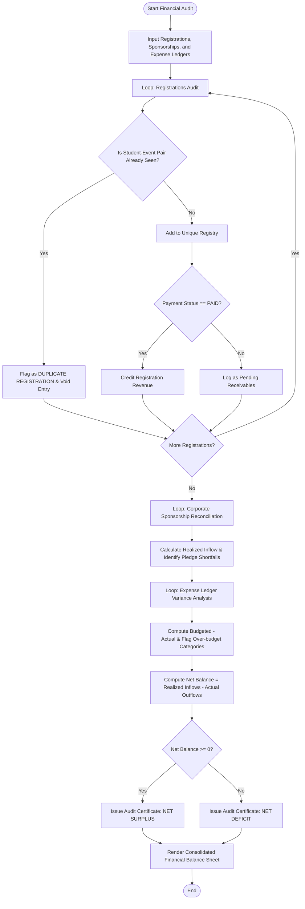

# Case Study 09: Campus Festival Registration and Financial Audit System

## 1. Problem Statement
Write a Python program to record festival registrations, sponsorships, and expenses. The program finds duplicate registrations, compares the budget with the actual spending, and prints the final balance.

---

## 2. Objectives
- **Data Integration Across Disparate Streams:** Aggregate registration tuples, sponsorship tuples, and multi-category expense nested lists.
- **Duplicate Registration Filtration:** Detect duplicate event entries ($(\text{Student ID}, \text{Event Code})$ tuples) using list-based uniqueness tracking without external hashing libraries or sets.
- **Sponsorship Realization Analysis:** Reconcile committed contract values against realized payments across corporate sponsorship tiers.
- **Budgetary Variance Auditing:** Calculate expense variances $(\text{Budget} - \text{Actual})$ per operational category and flag cost overruns.
- **Institutional Net Worth Statement:** Deliver a final balance sheet reflecting Net Surplus or Deficit.

---

## 3. Assumptions
1. Registrations are tuples:
   `(reg_id, student_id, student_name, event_code, fee_paid, payment_status)`
2. A duplicate occurs when the same `student_id` registers for the same `event_code` multiple times.
3. Corporate sponsorships are tuples:
   `(sponsor_id, company_name, tier, committed_amount, received_amount)`
4. Operational expenses are stored in a nested list:
   `[[category, item_desc, budgeted_amount, actual_amount], ...]`
5. Total Inflow = Verified Paid Registrations + Realized Sponsorships.
6. Net Position = Total Inflow - Actual Total Expenditures.

---

## 4. Algorithm
```
Step 1: Start.
Step 2: Function audit_festival_finances(registrations, sponsorships, expenses):
          Initialize seen_pairs = [], valid_regs = [], dup_regs = [].
          Initialize total_reg_collected = 0.0, pending_fees = 0.0.
          // Registration Audit
          For reg in registrations:
              Unpack (reg_id, s_id, s_name, ev_code, fee, status).
              key = s_id + "::" + ev_code.
              If key in seen_pairs:
                  Append reg to dup_regs.
              Else:
                  Append key to seen_pairs.
                  If status == "PAID":
                      Append reg to valid_regs.
                      total_reg_collected += fee.
                  Else:
                      pending_fees += fee.
          // Sponsorship Audit
          Initialize total_comm = 0, total_rec = 0, shortfalls = [].
          For sp in sponsorships:
              Unpack (sp_id, comp, tier, committed, received).
              total_comm += committed, total_rec += received.
              If committed > received:
                  Append shortfall record to shortfalls.
          // Expense Audit
          Initialize total_budget = 0, total_actual = 0, exp_summary = [].
          For exp in expenses:
              Unpack [cat, item, budgeted, actual].
              total_budget += budgeted, total_actual += actual.
              variance = budgeted - actual.
              is_over = (actual > budgeted).
              Append (cat, item, budgeted, actual, variance, is_over) to exp_summary.
          // Net Position
          total_income = total_reg_collected + total_rec.
          net_balance = total_income - total_actual.
          is_surplus = (net_balance >= 0).
          Return audit_data.
Step 3: Print structured audit report tables: Registrations & Duplicates, Sponsorships, Budget Variances, and Balance Sheet.
Step 4: Stop.
```

---

## 5. Flowchart

### Mermaid Representation


### Text / ASCII Flowchart
```
  +-------------------------------------------------------+
  |                        START                          |
  +-------------------------------------------------------+
                             |
                             v
  +-------------------------------------------------------+
  | Inflow Audit 1: Registrations                         |
  | Check Student-Event duplicate key                     |
  | - If seen -> Flag Duplicate & Exclude                 |
  | - If unique & PAID -> Add to Revenue                  |
  +-------------------------------------------------------+
                             |
                             v
  +-------------------------------------------------------+
  | Inflow Audit 2: Corporate Sponsorships                |
  | Sum received funds, compute shortfall = comm - rec    |
  +-------------------------------------------------------+
                             |
                             v
  +-------------------------------------------------------+
  | Outflow Audit: Itemized Expenses Ledger               |
  | Variance = Budget - Actual                            |
  | Flag Over-Budget items (Actual > Budget)              |
  +-------------------------------------------------------+
                             |
                             v
  +-------------------------------------------------------+
  | Final Balance Sheet:                                  |
  | Total Income = Reg Fees + Sponsorships                |
  | Net Balance = Total Income - Total Expenses           |
  | Outcome: Surplus (+ve) or Deficit (-ve)               |
  +-------------------------------------------------------+
                             |
                             v
  +-------------------------------------------------------+
  |                         END                           |
  +-------------------------------------------------------+
```

---

## 6. Pseudocode
```
BEGIN CampusFestivalFinancialAudit
    INPUT registrations, sponsorships, expenses
    SET seen_keys = []
    SET reg_rev = 0, pending_rev = 0
    SET dup_list = []

    FOR EACH reg IN registrations DO
        UNPACK reg INTO (rid, sid, sname, ev, fee, stat)
        SET key = sid + ":" + ev
        IF key IN seen_keys THEN
            APPEND reg TO dup_list
        ELSE
            APPEND key TO seen_keys
            IF stat == "PAID" THEN
                reg_rev = reg_rev + fee
            ELSE
                pending_rev = pending_rev + fee
            END IF
        END IF
    END FOR

    SET spon_rev = 0
    FOR EACH sp IN sponsorships DO
        UNPACK sp INTO (spid, comp, tier, comm, rec)
        spon_rev = spon_rev + rec
    END FOR

    SET tot_exp = 0
    FOR EACH exp IN expenses DO
        UNPACK exp INTO (cat, item, bud, act)
        tot_exp = tot_exp + act
        SET var = bud - act
        PRINT_VARIANCE(cat, item, bud, act, var)
    END FOR

    SET gross_inc = reg_rev + spon_rev
    SET net_balance = gross_inc - tot_exp
    SET is_surplus = (net_balance >= 0)

    PRINT_BALANCE_SHEET(gross_inc, tot_exp, net_balance, is_surplus)
END
```

---

## 7. Python Source Code
Refer to the complete script in [`problem_74_festival_audit.py`](file:///c:/Users/manikanta/OneDrive/Desktop/python/python%20active%20based/Case_Study_09_Campus_Festival_Financial_Audit/problem_74_festival_audit.py).

---

## 8. Test Cases

| Test Case ID | Scenario / Input Description | Expected Outcome | Actual Result | Status |
| :--- | :--- | :--- | :--- | :--- |
| **TC-09-01** | Duplicate entry detection: same student ID registered twice for `EVENT_X` | 1 valid entry counted, second flagged as duplicate; 500 INR revenue | 1 duplicate flagged; 500 INR collected | **PASSED** |
| **TC-09-02** | Different event registration by same student (`EVENT_X` and `EVENT_Y`) | Both registered as valid; 800 INR collected | 2 valid entries; 800 INR collected | **PASSED** |
| **TC-09-03** | Sponsorship shortfall: Committed 100k, Received 75k | 25,000 INR collection shortfall flagged | 25,000 INR shortfall logged | **PASSED** |
| **TC-09-04** | Net deficit condition: Inflow 10,000, Outflow 12,000 | Net Balance = -2,000 INR; Flagged as OPERATIONAL DEFICIT | -2,000 INR; Deficit confirmed | **PASSED** |

---

## 9. Output Execution Log
```
=========================================================================================================
                    DR. RVR NRI INSTITUTE OF TECHNOLOGY
        ANNUAL TECHNO-CULTURAL FESTIVAL: COMPREHENSIVE FINANCIAL AUDIT
=========================================================================================================

[SECTION 1: PARTICIPANT REGISTRATION & DUPLICATE ENTRY AUDIT]
Total Entries Audited   : 6
Verified Paid Entries   : 4
Duplicate Entries Flagged: 1
Total Fees Collected    : INR   1,900.00
Unpaid / Pending Fees   : INR     600.00

  >> FLAGGED DUPLICATE REGISTRATIONS (ACTION: VOID & REFUND)
  Reg ID    Student ID    Name                Event         Fee Paid  
  --------------------------------------------------------------------
  REG-003   26B91A0501    Aarav Sharma        CODE-HACK     INR 500.00
---------------------------------------------------------------------------------------------------------

[SECTION 2: CORPORATE SPONSORSHIP RECONCILIATION]
Sponsor ID  Company Name          Tier          Committed(INR)  Received(INR)   Shortfall
---------------------------------------------------------------------------------------------------------
SP-01       TechCorp Global       Title Sponsor 150,000.00      150,000.00      NIL
SP-02       V-Infotech Labs       Platinum Sponsor80,000.00       70,000.00       INR 10,000.00
SP-03       NextGen Robotics      Gold Sponsor  40,000.00       40,000.00       NIL
---------------------------------------------------------------------------------------------------------

[SECTION 3: ITEMIZED EXPENDITURE & VARIANCE ANALYSIS]
Category        Item Description        Budget(INR)   Actual(INR)   Variance(INR) Audit Alert
---------------------------------------------------------------------------------------------------------
Venue & Stage   Main Auditorium Setup   50,000.00     48,000.00     +2,000.00     Under Budget
Audio-Visual    Sound & LED Displays    45,000.00     47,000.00     -2,000.00     OVER-BUDGET [!]
Guest Honoraria Keynote Speakers Travel 35,000.00     32,000.00     +3,000.00     Under Budget
Catering        Student & Guest Meals   60,000.00     64,000.00     -4,000.00     OVER-BUDGET [!]
Certificates    Trophies and Badges     25,000.00     21,000.00     +4,000.00     Under Budget
---------------------------------------------------------------------------------------------------------

[SECTION 4: FINAL RECONCILIATION BALANCE SHEET]
  Total Revenue Collected from Registrations : INR     1,900.00
  Total Corporate Sponsorships Realized     : INR   260,000.00
  -------------------------------------------------------------
  TOTAL GROSS REVENUE                       : INR   261,900.00
  LESS: TOTAL FESTIVAL EXPENDITURES         : INR   212,000.00
  =============================================================
  >>> NET FINANCIAL SURPLUS                 : INR    49,900.00
=========================================================================================================
```

---

## 10. Conclusion
This case study illustrates how multi-source institutional financial ledgers are consolidated and audited using lists, tuples, and nested arrays. Computational tracking prevents financial leakages, identifies vendor overruns, and ensures full financial accountability.
