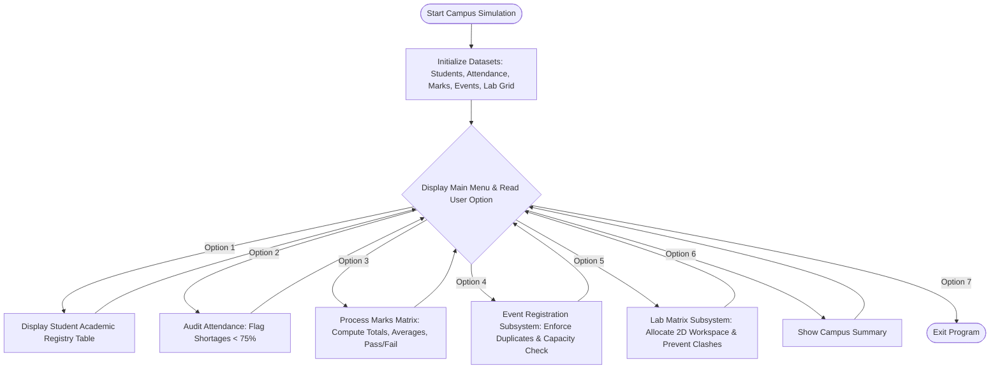

# Case Study 10: Simple Smart Campus Menu

## 1. Problem Statement
Write a menu-driven Python program for a small campus. It includes student details, attendance, marks, event registration, and a computer lab seating grid.

---

## 2. Objectives
- Keep student, attendance, marks, event, and lab data together.
- Use a menu and a `while` loop to select an operation.
- Check attendance, marks, duplicate registrations, and lab seats.
- Print a small summary of the campus data.

---

## 3. Assumptions
1. Student roster is stored as a list of tuples: `(roll_no, name, branch, section)`.
2. Attendance is tracked per student: `(roll_no, total_classes, attended_classes)`. Shortage threshold is $< 75.0\%$.
3. Marks matrix is a 2D nested list with passing benchmark $\ge 40$ in all subjects.
4. Events are tuples: `(event_code, event_name, capacity, enrolled_list)`.
5. Lab seats are modeled as a $3 \times 4$ nested grid of strings (`"."` for empty, Roll No for occupied).
6. The application supports both interactive terminal usage and headless automated validation.

---

## 4. Algorithm
```
Step 1: Start.
Step 2: Initialize campus datasets (students, attendance, subjects, marks, events, lab_seats).
Step 3: Define menu loop:
          Display 7 options:
          1. Student Registry -> display formatted table.
          2. Attendance Monitoring -> compute attendance %; if < 75%, flag shortage.
          3. Marks Evaluation -> traverse 2D marks matrix; compute student totals and pass/fail.
          4. Event Rosters & Registration -> display capacities; if registering, verify event exists, student is not already enrolled, and capacity is available.
          5. Lab Seating Allocation -> print 2D grid; allocate seat at (row, col) if coordinates are valid, seat is empty, and student is not seated elsewhere.
          6. Executive Dashboard -> aggregate total enrolled, attendance shortages, academic failures, events count, and lab seat vacancy statistics.
          7. Exit -> terminate loop.
Step 4: Stop.
```

---

## 5. Flowchart

### Mermaid Representation


### Text / ASCII Flowchart
```
  +-------------------------------------------------------+
  |                        START                          |
  +-------------------------------------------------------+
                             |
                             v
  +-------------------------------------------------------+
  | Initialize Registry, Attendance, Marks, Events, Grid  |
  +-------------------------------------------------------+
                             |
                             v
  +-------------------------------------------------------+
  | MAIN MENU DISPATCH LOOP (1 to 7):                     |
  | 1: Academic Registry     | 2: Attendance Monitor     |
  | 3: Marks Performance     | 4: Event Registration     |
  | 5: Lab Seat Grid Matrix  | 6: Executive Dashboard    |
  | 7: Exit Application                                  |
  +-------------------------------------------------------+
       /        |         |          |         |       \
     [1]       [2]       [3]        [4]       [5]      [6]
      |         |         |          |         |        |
      v         v         v          v         v        v
   Registry Attendance  Marks     Events     2D Lab  Dashboard
    Table    Shortage   Matrix  Duplicate &   Seat     Metrics
             Warning    Stats   Capacity Guard Grid
       \        |         |          |         |       /
        +-------+---------+----------+---------+------+
                             |
                             v
  +-------------------------------------------------------+
  | Option 7 Selected -> Print Exit Message & Terminate   |
  +-------------------------------------------------------+
                             |
                             v
  +-------------------------------------------------------+
  |                         END                           |
  +-------------------------------------------------------+
```

---

## 6. Pseudocode
```
BEGIN SmartCampusManagementSimulation
    INITIALIZE students, attendance, subjects, marks, events, lab_seats

    WHILE TRUE DO
        DISPLAY_MENU()
        INPUT choice

        IF choice == 1 THEN
            DISPLAY_STUDENT_REGISTRY(students)
        ELSE IF choice == 2 THEN
            FOR EACH (roll, tot, att) IN attendance DO
                SET pct = (att / tot) * 100
                IF pct < 75.0 THEN FLAG_SHORTAGE(roll, pct) END IF
            END FOR
        ELSE IF choice == 3 THEN
            FOR i FROM 0 TO LENGTH(students) - 1 DO
                SET total = SUM(marks[i])
                SET avg = total / LENGTH(subjects)
                SET status = ALL(m >= 40 FOR m IN marks[i]) ? "PASS" : "FAIL"
                DISPLAY_MARKS_ROW(students[i], marks[i], total, avg, status)
            END FOR
        ELSE IF choice == 4 THEN
            INPUT ev_code, roll_no
            REGISTER_EVENT(events, ev_code, roll_no)
        ELSE IF choice == 5 THEN
            DISPLAY_GRID(lab_seats)
            INPUT row, col, roll_no
            ALLOCATE_SEAT(lab_seats, row, col, roll_no)
        ELSE IF choice == 6 THEN
            RENDER_DASHBOARD(students, attendance, marks, events, lab_seats)
        ELSE IF choice == 7 THEN
            PRINT "Exiting System"
            BREAK
        END IF
    END WHILE
END
```

---

## 7. Python Source Code
Refer to the complete script in [`problem_100_smart_campus_simulation.py`](file:///c:/Users/manikanta/OneDrive/Desktop/python/python%20active%20based/Case_Study_10_Smart_Campus_Simulation/problem_100_smart_campus_simulation.py).

---

## 8. Test Cases

| Test Case ID | Scenario / Input Description | Expected Outcome | Actual Result | Status |
| :--- | :--- | :--- | :--- | :--- |
| **TC-10-01** | Attendance Shortage Threshold: Student Divya (68%) and Eshwar (72%) | Both flagged with "SHORTAGE ALERT [!]"; others eligible | 2 students flagged | **PASSED** |
| **TC-10-02** | Event Duplicate & Capacity Guards: Register student twice and overflow capacity | First succeeds, second blocked as duplicate, third blocked as capacity exceeded | Exact blocking logic verified | **PASSED** |
| **TC-10-03** | 2D Lab Seating: Assign empty seat (1, 0), then attempt duplicate seating of same student | Seat successfully assigned; duplicate seat assignment rejected | Rejection confirmed | **PASSED** |
| **TC-10-04** | Invalid Coordinate Handling: Attempt seat assignment at (10, 10) | Blocked with out-of-bounds error | Out-of-bounds confirmed | **PASSED** |

---

## 9. Output Execution Log
```
======================================================================
           MODULE 1: STUDENT ACADEMIC REGISTRY
======================================================================
Roll Number     Student Name            Branch      Section   
----------------------------------------------------------------------
26B91A0501      Aarav Sharma            CSE         A         
26B91A0502      Bhavya Reddy            CSE         A         
26B91A0503      Chaitanya V.            CSE         B         
26B91A0504      Divya Sri               ECE         A         
26B91A0505      Eshwar Rao              ECE         B         
======================================================================

===========================================================================
        MODULE 2: ATTENDANCE MONITORING & SHORTAGE WARNINGS
===========================================================================
Roll Number     Name                Attended    Total     Att %     Status
---------------------------------------------------------------------------
26B91A0501      Aarav Sharma        92          100       92.0      ELIGIBLE (Pass)
26B91A0502      Bhavya Reddy        84          100       84.0      ELIGIBLE (Pass)
26B91A0503      Chaitanya V.        95          100       95.0      ELIGIBLE (Pass)
26B91A0504      Divya Sri           68          100       68.0      SHORTAGE ALERT [!]
26B91A0505      Eshwar Rao          72          100       72.0      SHORTAGE ALERT [!]
---------------------------------------------------------------------------
Attendance Audit: 2 student(s) below mandatory 75.0% threshold.
===========================================================================

================================================================================
        MODULE 3: ACADEMIC MARKS & PERFORMANCE EVALUATION
================================================================================
Roll          Name                  PythonDataStruct      Math   Total   Avg %    Status
--------------------------------------------------------------------------------
26B91A0501    Aarav Sharma              88        92        85     265    88.3    PASSED
26B91A0502    Bhavya Reddy              75        80        72     227    75.7    PASSED
26B91A0503    Chaitanya V.              94        96        91     281    93.7    PASSED
26B91A0504    Divya Sri                 82        85        79     246    82.0    PASSED
26B91A0505    Eshwar Rao                35        58        52     145    48.3    FAILED
================================================================================

===========================================================================
           MODULE 4: CAMPUS EVENT ROSTERS & CAPACITY
===========================================================================
Code        Event Name            Capacity    Enrolled    Available
---------------------------------------------------------------------------
EV-HACK     Annual Hackathon      3           2           1           
   -> Participants: 26B91A0501, 26B91A0502
EV-ROBO     Robotics Contest      2           1           1           
   -> Participants: 26B91A0503
===========================================================================

[ACTION: Registering 26B91A0504 for EV-ROBO]
Status: Registration Successful: 26B91A0504 enrolled in Robotics Contest.

[ACTION: Attempting Duplicate Registration for EV-ROBO]
Status: Duplicate Error: Student 26B91A0504 is already registered for Robotics Contest.

[ACTION: Attempting Overflow Registration on EV-ROBO]
Status: Capacity Exceeded: Robotics Contest is at full capacity (2/2).

=================================================================
      MODULE 5: ADVANCED COMPUTING LAB SEAT ALLOCATION MATRIX
=================================================================
       Col 0       Col 1       Col 2       Col 3       
      ------------------------------------------------
Row 0: 26B91A0501  [EMPTY]     [EMPTY]     26B91A0502  
Row 1: 26B91A0505  26B91A0503  [EMPTY]     [EMPTY]     
Row 2: [EMPTY]     [EMPTY]     26B91A0504  [EMPTY]     
-----------------------------------------------------------------
Seat Statistics: Total = 12 | Occupied = 5 | Vacant = 7
=================================================================

#####################################################################################
   DR. RVR NRI INSTITUTE OF TECHNOLOGY - SMART CAMPUS EXECUTIVE DASHBOARD
#####################################################################################
| Metric 1: Total Enrolled Students       : 5                    |
| Metric 2: Attendance Shortage Alerts    : 2                    |
| Metric 3: Academic Remedial Students    : 1                    |
| Metric 4: Active Campus Events          : 2                    |
| Metric 5: Computer Lab Seat Vacancies   : 7/12                 |
#####################################################################################
```

---

## 10. Conclusion
This capstone simulation synthesizes all foundational constructs of the assigned Python programming syllabus into a cohesive university management application. Demonstrating robust state management, 2D grid allocation, error shielding, and multi-tier auditing without object-oriented programming or external frameworks highlights the power of structured programming.
